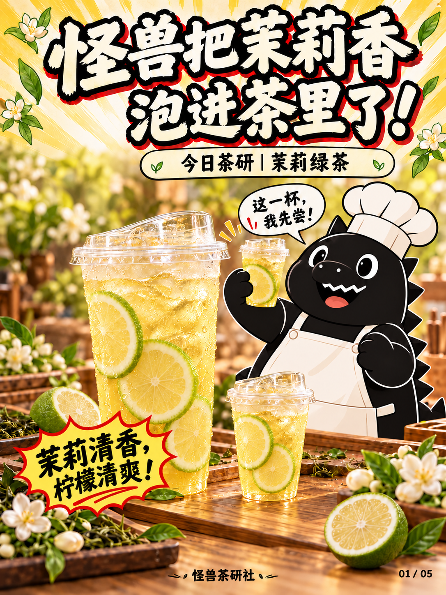

# 怪兽茶研社｜饮品漫画工作流2.0

## 当前模板与最新修订

- [模板一｜暖黄元气漫画风：不锈钢直杆柄修订](怪兽茶研社工作流/修订版本/2026-10-14-不锈钢直杆柄/README.md)：五页结构，第03页替换为新手柄修订图，其他页沿用标准原图。
- [模板二｜奶油手账食谱风](模板二-奶油手账食谱风/README.md)：四页结构，当前为[茉莉绿茶试稿v2](模板二-奶油手账食谱风/茉莉绿茶/试稿-v2/README.md)。

两套模板滤袋统一采用细长直杆式不锈钢柄，末端小挂环。五张标准原图、历史图片和模板二试稿v1均原样保留；以下五图入口仍指向原标准文件。

模板一原始工作流以用户指定的「封面.png、材料.png、步骤.png、雪克.png、封底.png」五张图为标准，已更新逐页布局、角色、器具及提示词。五张标准PNG已从用户上传的「茉莉绿茶.rar」原样导入，并记录SHA-256校验值；此前生成图作为历史版本保存。

## 开始使用

- [完整工作流](怪兽茶研社工作流/工作流.md)：五页结构、品牌偏好、器具规范、配方流程和检查项。
- [最新五图标准](怪兽茶研社工作流/五图标准.md)：五张用户指定标准图的布局、文案及角色规范。
- [可复用出图提示词](怪兽茶研社工作流/出图提示词.md)：通用画面规则、各页提示词和局部修改方式。
- [新主题输入模板](怪兽茶研社工作流/新主题输入模板.md)：填写饮品名称、实际原料、用量与步骤。
- [定稿清单](怪兽茶研社工作流/定稿清单.json)：图片版本、尺寸及校验值。
- [下载全部文档和图片](https://github.com/12321zcd/tea/archive/refs/heads/main.zip)。

在新聊天中提供工作流及参考图片，再输入：

> 沿用「怪兽茶研社五页漫画工作流2.0」，以封面、材料、步骤、雪克、封底五张标准图为准。新主题：[饮品名称]。配方：[原料、用量、顺序、时间]。请生成同结构的新五页。

## 五张标准原图

| 页码 | 标准图片 |
| --- | --- |
| 01 | [封面](怪兽茶研社工作流/标准原图/封面.png) |
| 02 | [材料](怪兽茶研社工作流/标准原图/材料.png) |
| 03 | [步骤](怪兽茶研社工作流/标准原图/步骤.png) |
| 04 | [雪克](怪兽茶研社工作流/标准原图/雪克.png) |
| 05 | [封底](怪兽茶研社工作流/标准原图/封底.png) |

## 历史图片

标准图的逐页要求已记录于[五图标准](怪兽茶研社工作流/五图标准.md)。文件来源详见[标准原图说明](怪兽茶研社工作流/标准原图/README.md)。下面是此前已保存的历史图片，不作为2.0版标准原图。

| 页码 | 图片 | 内容 |
| --- | --- | --- |
| 01 | [历史封面](怪兽茶研社工作流/历史版本/v1/图片/01-封面.png) | 旧版含制作小窗与比例条；新版标准已取消 |
| 02 | [历史原料页](怪兽茶研社工作流/历史版本/v1/图片/02-原料准备.png) | 此前生成的原料页，保留追溯 |
| 03 | [历史步骤页](怪兽茶研社工作流/历史版本/v1/图片/03-四步茶汤制作.png) | 此前生成的四步页，保留追溯 |
| 04 | [历史雪克页](怪兽茶研社工作流/历史版本/v1/图片/04-雪克动作.png) | 旧版含底部比例条；新版标准已取消 |
| 05 | [历史封底](怪兽茶研社工作流/历史版本/v1/图片/05-成品收尾.png) | 此前生成的收尾页，保留追溯 |

标准原图保持用户文件内容不变，未重绘、压缩或重新编码。

## 本期茶汤基底配方

1. 称取茶叶50克。
2. 加入1250克热水，盖上焖泡10分钟。
3. 用不锈钢直杆柄布滤袋过滤茶渣，取出茶汤。
4. 倒入750克冰块，搅拌均匀后可用。

茶叶∶热水∶冰块＝1∶25∶15，按重量配比。出品加入绿色香水柠檬片。

这是批量茶汤基底配方。单杯用量、香水柠檬用量和热水具体温度尚未提供。

## 已确认视觉偏好（模板一）

- 怪兽使用稍扁平的漫画风，保持黑色轮廓、白色细节和同一角色外形，减少绒毛质感及立体阴影。
- 成品杯沿用透明外带塑料杯和凸起透明饮口盖，所有杯身无文字或标志。
- 柠檬使用绿皮香水柠檬，淡黄果肉；封面产品名写「今日茶研｜茉莉绿茶」。
- 泡茶及接茶器具使用直筒刻度透明玻璃壶；过滤使用长锥形棕色布滤袋，配细长直杆式不锈钢柄（末端小挂环）。
- 五页结构为封面、原料、完整步骤、关键动作、成品收尾。步骤格数按真实配方安排。
- 本版怪兽以指定五图中的圆润漫画厨师形象为准；封面无制作小窗及比例条，原料页保留基底比例，步骤页默认四格，雪克页无底部比例条，封底保留三格表情与完整配方卡。
