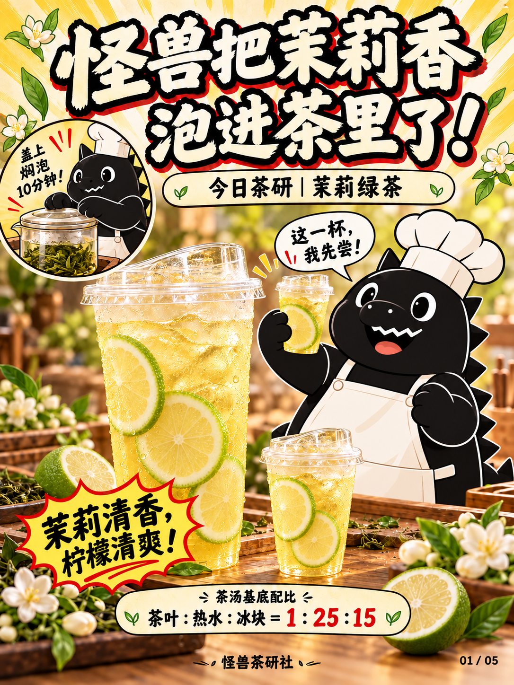

# 怪兽茶研社｜饮品漫画工作流

保存「怪兽茶研社」五页饮品图文的制作工作流，以及茉莉绿茶案例的五张最新版图片。

## 开始使用

- [完整工作流](怪兽茶研社工作流/工作流.md)：五页结构、品牌偏好、器具规范、配方流程和检查项。
- [可复用出图提示词](怪兽茶研社工作流/出图提示词.md)：通用画面规则、各页提示词和局部修改方式。
- [新主题输入模板](怪兽茶研社工作流/新主题输入模板.md)：填写饮品名称、实际原料、用量与步骤。
- [定稿清单](怪兽茶研社工作流/定稿清单.json)：图片版本、尺寸及校验值。
- [下载全部文档和图片](https://github.com/12321zcd/tea/archive/refs/heads/main.zip)。

在新聊天中提供工作流及参考图片，再输入：

> 沿用「怪兽茶研社五页漫画工作流」。新主题：[饮品名称]。配方：[原料、用量、顺序、时间]。关键动作：[动作]。请生成同结构的新五页。

## 当前茉莉绿茶五页定稿

| 页码 | 图片 | 内容 |
| --- | --- | --- |
| 01 | [封面](怪兽茶研社工作流/最新定稿/01-封面.png) | 茉莉绿茶、无字外带杯、绿色香水柠檬片、扁平漫画怪兽 |
| 02 | [原料准备](怪兽茶研社工作流/最新定稿/02-原料准备.png) | 茶叶、热水、冰块、绿色香水柠檬、直筒刻度玻璃壶 |
| 03 | [四步茶汤制作](怪兽茶研社工作流/最新定稿/03-四步茶汤制作.png) | 称茶、盖上焖泡、布滤袋过滤、加冰搅匀 |
| 04 | [雪克动作](怪兽茶研社工作流/最新定稿/04-雪克动作.png) | 双手握紧密封雪克壶来回摇匀 |
| 05 | [成品收尾](怪兽茶研社工作流/最新定稿/05-成品收尾.png) | 成品特写、期待/惊喜/满足三格及完整四步配方卡 |

## 本期茶汤基底配方

1. 称取茶叶50克。
2. 加入1250克热水，盖上焖泡10分钟。
3. 用红柄布滤袋过滤茶渣，取出茶汤。
4. 倒入750克冰块，搅拌均匀后可用。

茶叶∶热水∶冰块＝1∶25∶15，按重量配比。出品加入绿色香水柠檬片。

这是批量茶汤基底配方。单杯用量、香水柠檬用量和热水具体温度尚未提供。

## 已确认视觉偏好

- 怪兽使用稍扁平的漫画风，保持黑色轮廓、白色细节和同一角色外形，减少绒毛质感及立体阴影。
- 成品杯沿用透明外带塑料杯和凸起透明饮口盖，所有杯身无文字或标志。
- 柠檬使用绿皮香水柠檬，淡黄果肉；封面产品名写「今日茶研｜茉莉绿茶」。
- 泡茶及接茶器具使用直筒刻度透明玻璃壶；过滤使用红柄长锥形棕色布滤袋。
- 五页结构为封面、原料、完整步骤、关键动作、成品收尾。步骤格数按真实配方安排。
