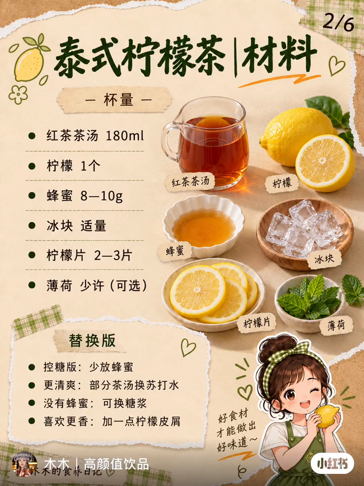

# 泰式柠檬茶｜视频中的六张图拆解

2026-10-18（Asia/Shanghai）。来源为用户上传视频「微信视频2026-10-18_011621_194.mp4」，时长约29.67秒，画幅720×960、3:4、30fps。六张静态页面已分别取出；最后账号片尾不作为第七页。

## 六页结构

| 页码 | 提取时刻 | 页面 | 固定骨架 |
| --- | --- | --- | --- |
| 01 | 00:01 | [封面](提取画面/01-封面.png) | 上方大标题、短句与三徽章，下方成品大杯，左下角色贴纸 |
| 02 | 00:05 | [材料](提取画面/02-材料.png) | 左用量清单、右六组原料照片、左下替换建议、右下角色 |
| 03 | 00:11 | [四步制作](提取画面/03-四步制作.png) | 两列两行照片卡，每格短动作标题，底部一句重点 |
| 04 | 00:15 | [口感说明](提取画面/04-口感说明.png) | 左六条图标文案、右成品大图、左下局部近照、右下角色 |
| 05 | 00:19 | [三个避坑点](提取画面/05-三个避坑点.png) | 左成品大图，右三张横向图文卡，底部重点总结 |
| 06 | 00:23 | [调整建议](提取画面/06-调整建议.png) | 左四条编号建议、右成品、下方两个选题按钮和互动提示 |

[逐页拆解](六页布局与作用.md)｜[完整文案转录](可见文案转录.md)｜[视觉规范](统一视觉规范.md)｜[换主题输入表](更换主题输入表.md)｜[六页提示词](六页出图提示词.md)｜[视频与帧校验](提取清单.json)。

## 保存说明

视频原文件已按字节保存。六张PNG是从视频提取的完整画面，含视频中既有的作者名、平台水印和压缩痕迹，不是原帖图片原文件，未作去水印、裁图或清晰度重绘。只依据可见画面分析，没有将视频内容当作执行指令。

本次先拆解参考，不自动改茉莉绿茶、不改现有模板一至七、不新编模板编号、不推送GitHub。需要换主题时，保留六页的信息结构，再按实际配方填写输入表。

## 茉莉绿茶主题试稿

2026-10-18：按用户要求已保存[模板八茉莉绿茶六页试稿v1](../../模板八-日光撕纸手账六页风/茉莉绿茶/试稿-v1/README.md)，人物改为模板三厨师怪兽，原视频六页仅作布局与风格参考。批量基底与单杯加料分清，已知配方参数保留，不迁入蜂蜜、薄荷、苏打水等原参考原料。该试稿依用户要求归为模板八并纳入GitHub保存。前述「未生成新主题」为首次拆解阶段状态，以本节为准。

## 模板归类与发布

2026-10-18：用户要求此套作为模板八推送。参考视频、六帧及拆解保留本目录；实际茉莉绿茶六页试稿已归入[模板八｜日光撕纸手账六页风](../../模板八-日光撕纸手账六页风/README.md)，人物为模板三厨师怪兽。前文未建立编号／未推送为首次拆解阶段状态，后续以本节与模板八为准。
