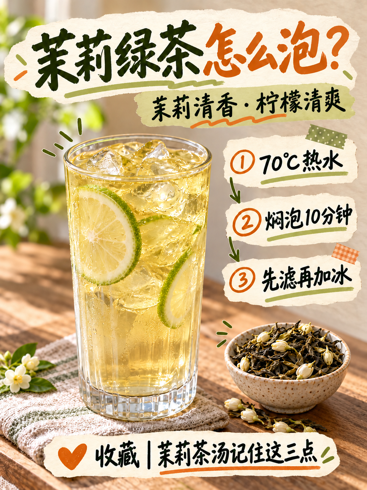

# 模板七｜茉莉绿茶封面试稿v1

2026-10-16（Asia/Shanghai）。按用户要求更换为茉莉绿茶主题。保留撕纸手账构图，原右下小杯替换成模板五款米色斑点陶碗与饱满茉莉干茶；左侧淡金茶汤与绿色柠檬，沿用封面参考的无盖透明玻璃高杯。标题改「茉莉绿茶怎么泡？」，右侧为70℃热水、焖泡10分钟、先滤再加冰三项已确认基底重点。

已清理首稿残留的抹茶茶筅及第二只碗，右下茶碗完整入镜。原参考图不是本页，首轮生成另存过程稿。按用户要求纳入GitHub版本保存。

[文案清单](文案清单.md)｜[生成提示词](生成提示词.json)｜[尺寸及SHA-256](归档清单.json)

