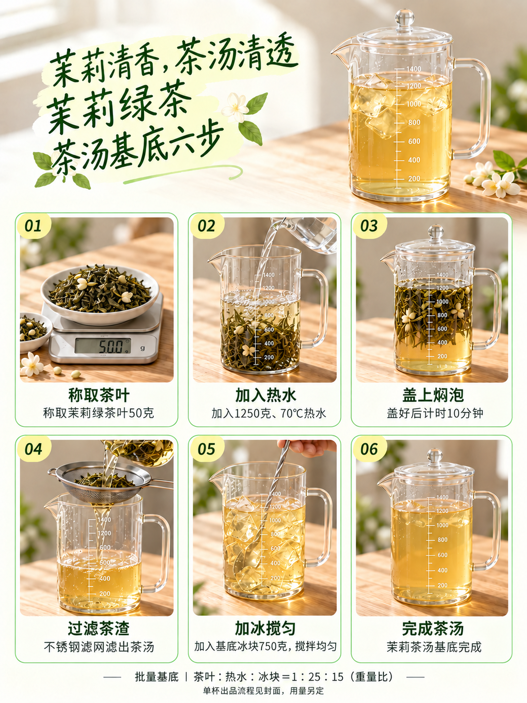

# 模板七｜茉莉绿茶四页组合｜试稿v2

2026-10-16（Asia/Shanghai）。按用户要求，以模板七茉莉绿茶封面，搭配模板六衍生版本的第二、三、四页。来源内页选择已发布的茉莉绿茶试稿v5。四张图片按原字节复制，无重新生成、裁切、压缩或重排。

| 页码 | 页面 | 来源 |
| --- | --- | --- |
| 01 | [茉莉绿茶封面](图片/01-茉莉绿茶封面.png) | 模板七试稿v1，撕纸大标题、三条提示、右下茶叶碗 |
| 02 | [食材实拍](图片/02-食材实拍.png) | 模板六衍生版v5，第02页 |
| 03 | [六格茶汤基底制作](图片/03-六格茶汤基底制作.png) | 模板六衍生版v5，第03页，从称茶到完成茶汤 |
| 04 | [成品窗边细高杯](图片/04-成品窗边细高杯.png) | 模板六衍生版v5，第04页，无logo、平盖及直吸管 |

四页实际尺寸均为1086×1448，3:4竖版。按用户要求纳入GitHub版本保存。原封面单页试稿v1及模板六衍生版均保留。

配方不变：茶叶50克、1250克70℃热水、盖后焖泡10分钟、过滤后加750克基底冰搅匀。单杯及加料用量另定。封面三条是基底制作重点；源内页文字和各页杯型按原图沿用，本轮未统一重绘。

[归档与校验清单](归档清单.json)｜[组合及文案说明](组合说明.md)

