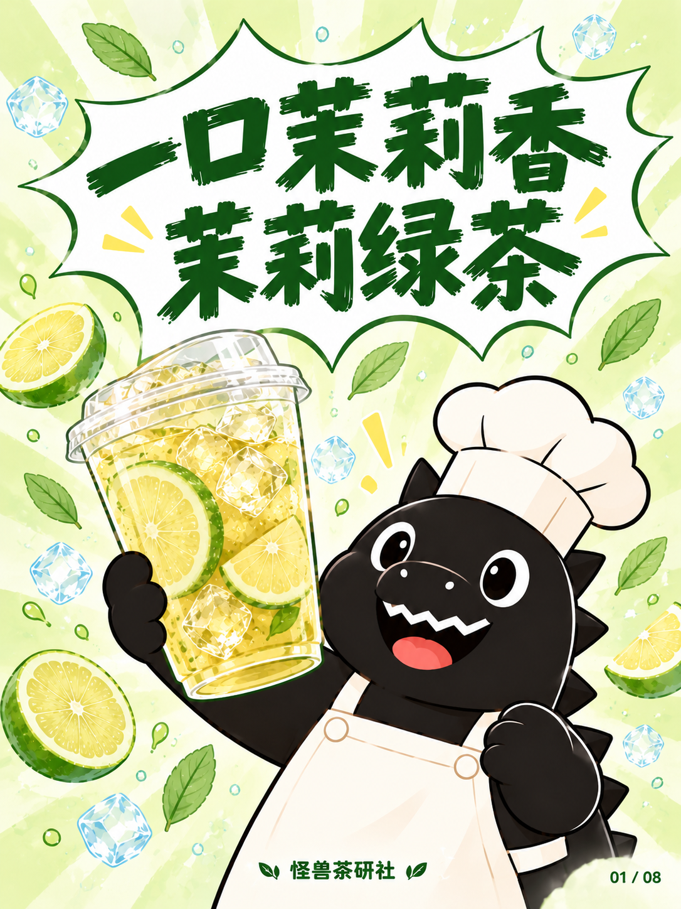
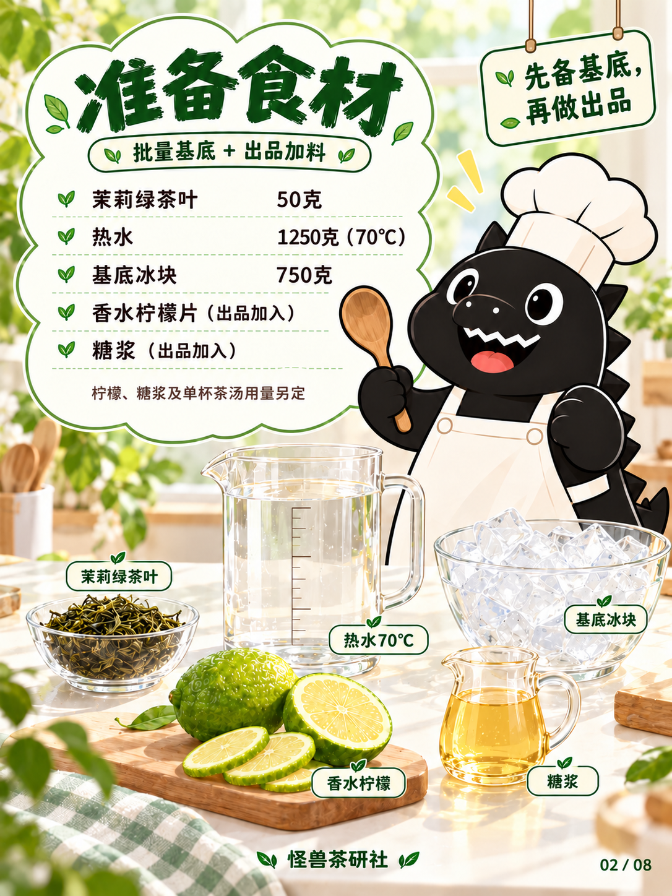
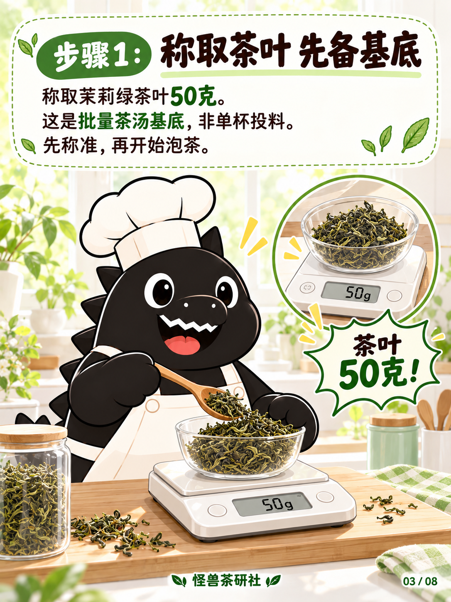
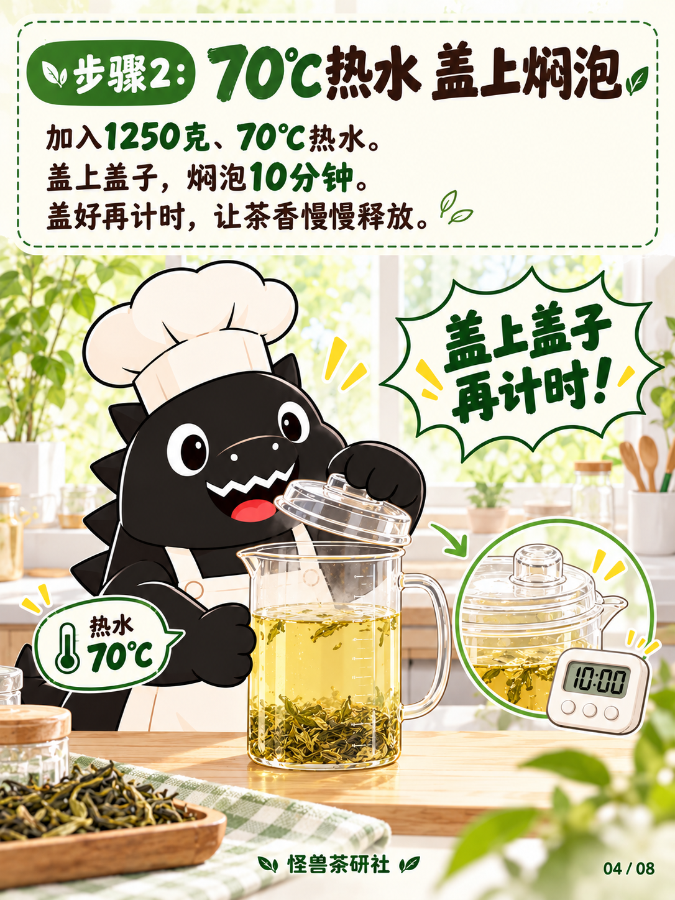
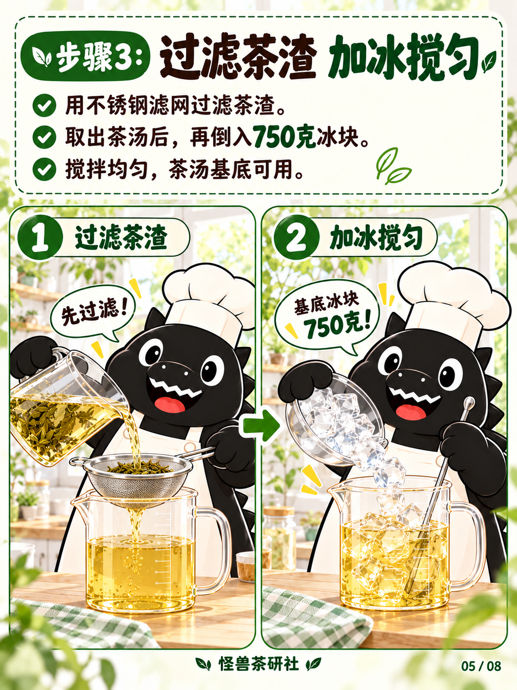
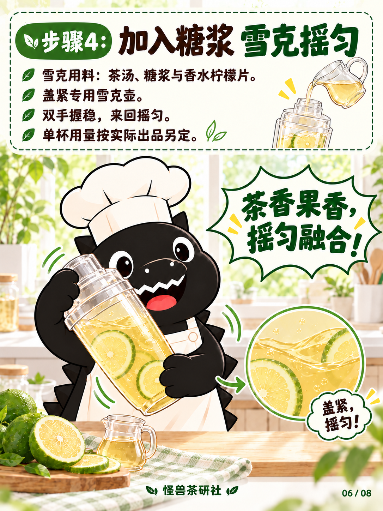
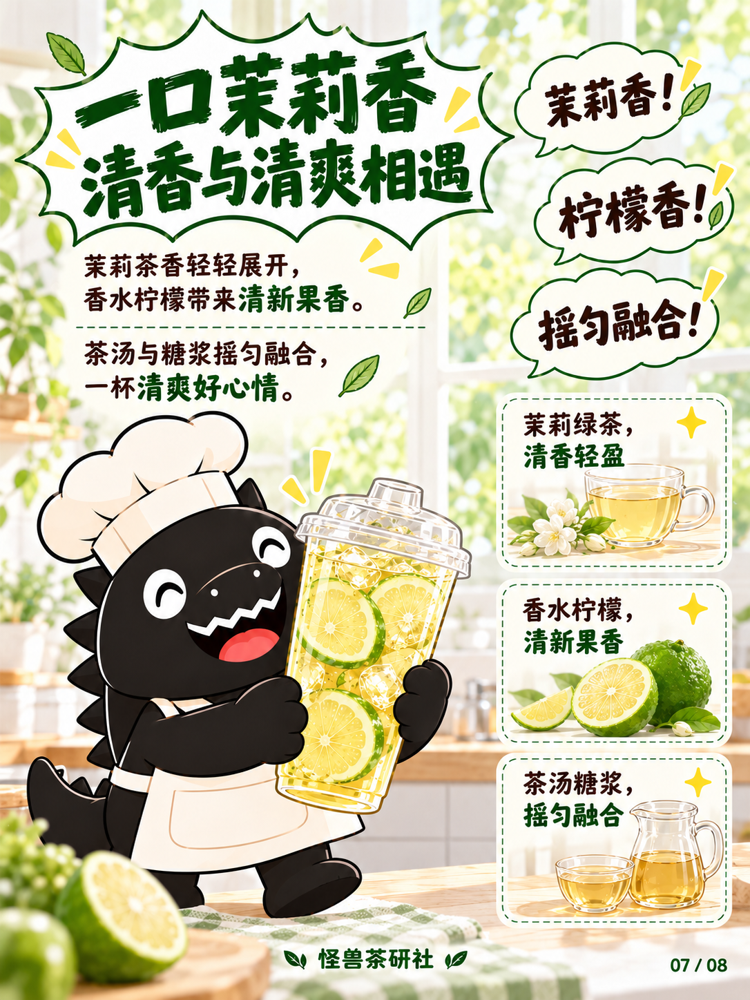
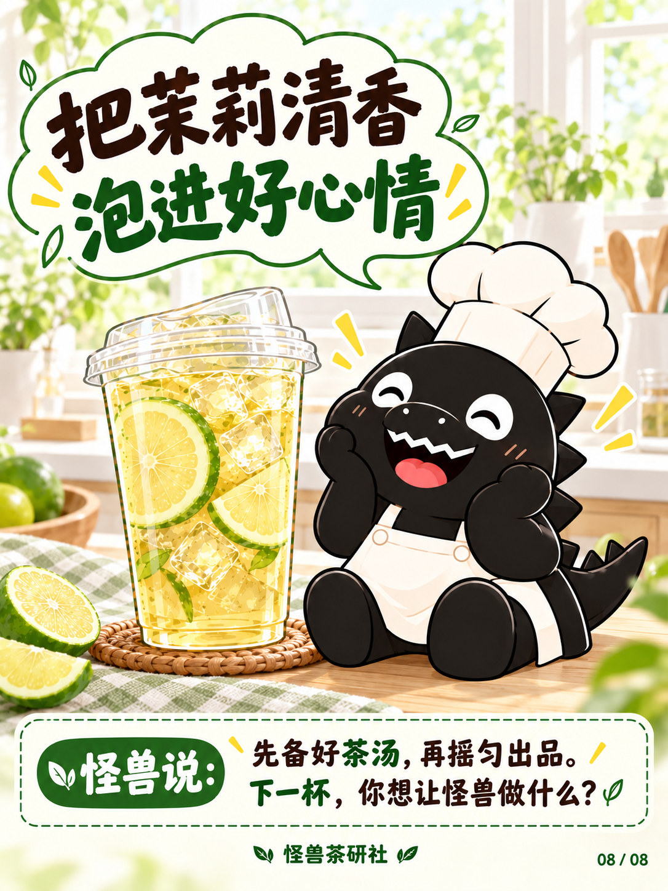

# 茉莉绿茶｜模板三清新试稿v2

保存日期：2026-10-14（Asia/Shanghai）。八页生成并核对完成，尚未宣告设计定稿。本期采用用户明确指定的模板一圆润厨师怪兽、白帽白围裙；采用模板三绿色配色、画风和八页布局。

根据用户「原图的清新风，太油腻」反馈，本版减少封面花朵、水花与强高光，内页使用奶油白说明区、绿色强调和柔光窗边场景。雪克页另外清理液体碎片状高光，食材页去掉未确认的壶容量数字。

## 当前八页

| 页码 | 图片 | 内容 |
| --- | --- | --- |
| 01 | [封面](图片/01-封面.png) | 两行爆炸标题、单杯举杯厨师怪兽 |
| 02 | [食材准备](图片/02-食材准备.png) | 云朵清单、基底与出品加料、原料静物 |
| 03 | [称取茶叶](图片/03-称取茶叶.png) | 50克茶叶、批量基底提示与秤特写 |
| 04 | [70℃焖泡](图片/04-70度焖泡.png) | 1250克、70℃热水，盖上焖泡10分钟 |
| 05 | [过滤加冰](图片/05-过滤加冰.png) | 双格：不锈钢滤网过滤，再加750克冰块搅匀 |
| 06 | [糖浆雪克](图片/06-糖浆雪克.png) | 茶汤、糖浆与香水柠檬片，双手密封雪克 |
| 07 | [风味卖点](图片/07-风味卖点.png) | 三个关键词气泡与三张竖排卖点卡 |
| 08 | [成品收尾](图片/08-成品收尾.png) | 满足坐姿怪兽、成品与收尾留言卡 |

最新配方见[当前配方](../../../当前配方.md)，本期文案见[文案清单](文案清单.md)。糖浆、柠檬与单杯茶汤用量未提供，未添加虚构数字。基底750克冰块保留，雪克步骤不列独立冰块；成品杯冰块沿用现有成品视觉，不能反推雪克投料。

图片尺寸1086×1448，原样复制未压缩或重新编码；尺寸、字节数、SHA-256与生成来源见[归档清单](归档清单.json)。此前[首版封面](../试稿-v1/README.md)保留；本版两张局部修改前图片另存过程稿，不作为当前页使用。本版图片、过程稿与配套文档按用户要求纳入本次GitHub保存。

## 逐页预览

