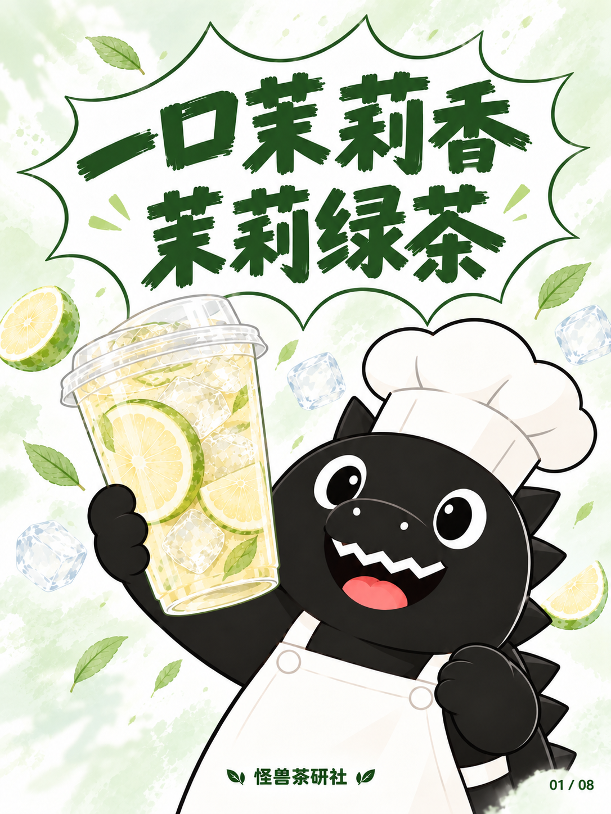
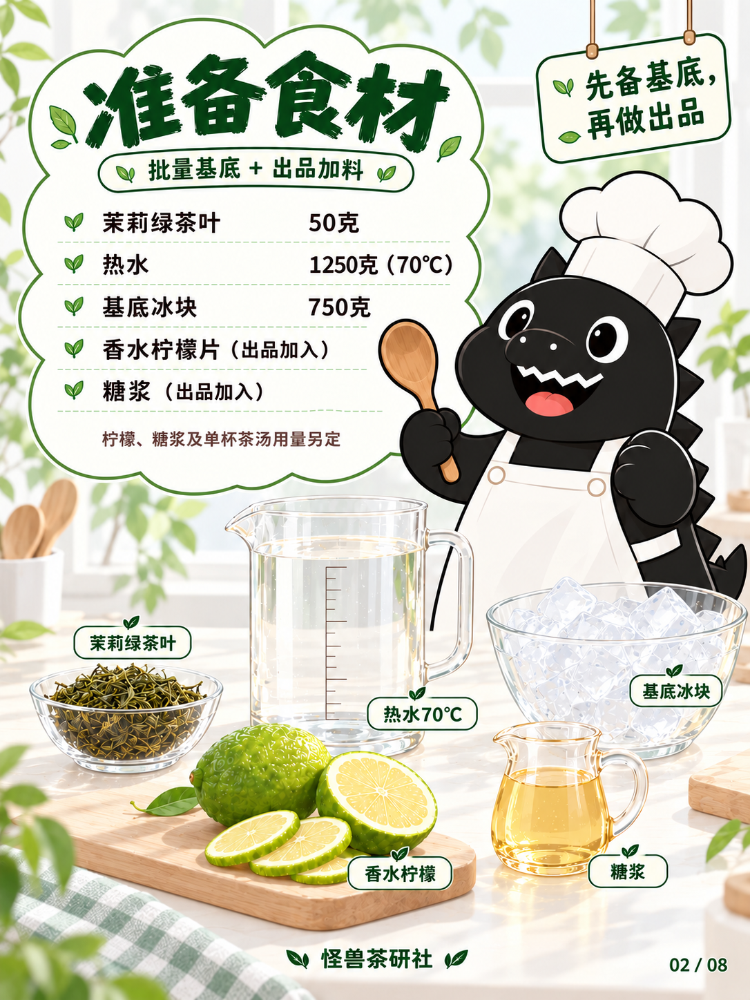
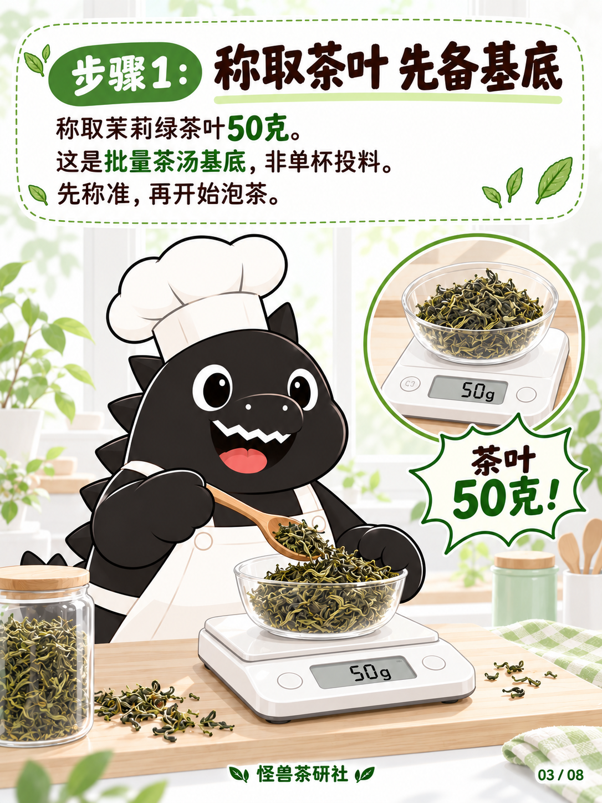
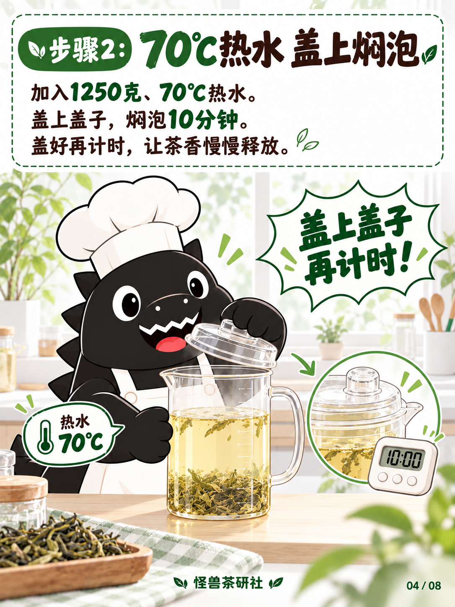
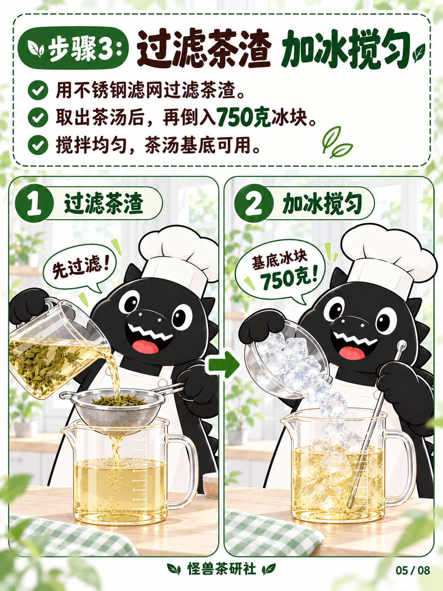
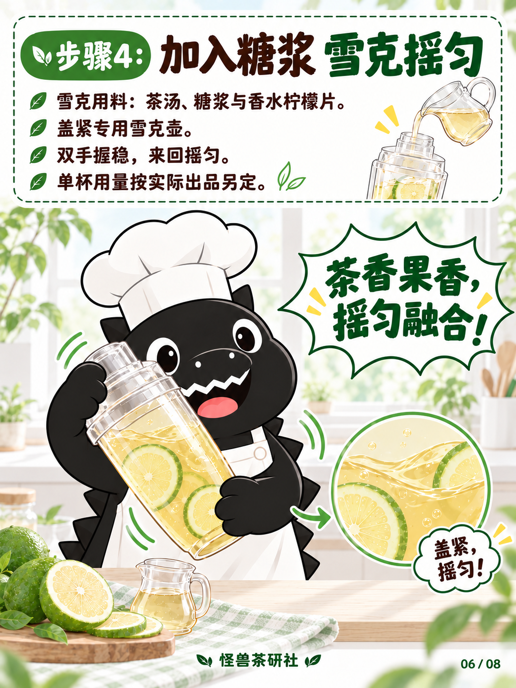
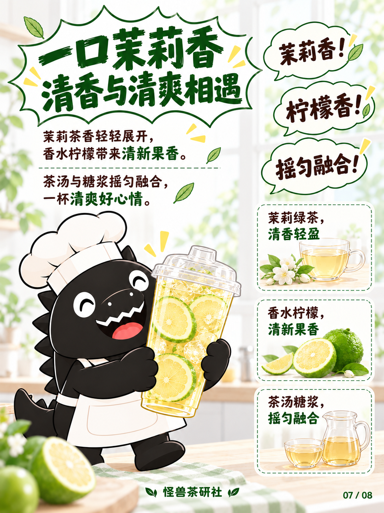
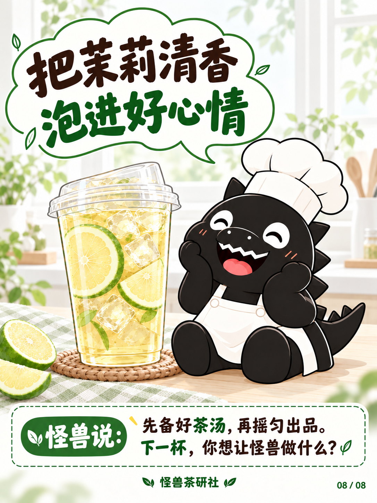

# 茉莉绿茶｜清朗淡雅试稿v3

保存日期：2026-10-14（Asia/Shanghai）。八页生成并核对完成，尚未宣告设计定稿。本期保留模板一圆润黑色厨师怪兽、白帽白围裙，模板三八页布局与最新配方。

用户最新要求整体「清朗淡雅」，封面怪兽的形态、角度与位置跟随原图。用户已补发猫咪原封面，本版直接参照它调整头部倾斜、下半部偏右位置、左侧举杯和右手胸前握拳；角色仍为模板一怪兽，帽子与围裙保留。

全套采用近白底色、柔和浅绿、轻透浅金茶汤及更简洁窗边场景，减少浓黄暖光、强高光和密集装饰。文案、用量、制作顺序与器具要求保持不变。

## 当前八页

| 页码 | 图片 | 内容 |
| --- | --- | --- |
| 01 | [封面](图片/01-封面.png) | 对照补发原图调整头部、举杯和握拳姿态 |
| 02 | [食材准备](图片/02-食材准备.png) | 云朵清单、五类食材与出品用量提示 |
| 03 | [称取茶叶](图片/03-称取茶叶.png) | 50克茶叶、非单杯投料、电子秤特写 |
| 04 | [70℃焖泡](图片/04-70度焖泡.png) | 1250克、70℃热水，盖上焖泡10分钟 |
| 05 | [过滤加冰](图片/05-过滤加冰.png) | 左右双格：先过滤，再加750克冰块搅匀 |
| 06 | [糖浆雪克](图片/06-糖浆雪克.png) | 茶汤、糖浆与柠檬片，密封双手雪克 |
| 07 | [风味卖点](图片/07-风味卖点.png) | 三个关键词气泡及三张竖排卖点卡 |
| 08 | [成品收尾](图片/08-成品收尾.png) | 坐姿满足怪兽、成品与收尾留言 |

图片1086×1448，原样保存未重新编码。校验和生成来源见[归档清单](归档清单.json)，逐页实际生成提示词见[生成提示词](生成提示词.json)，内容见[文案清单](文案清单.md)，配方见[当前配方](../../../当前配方.md)。糖浆、柠檬与单杯茶汤用量仍未指定，不添加虚构数字；基底750克冰块保留，雪克壶及其特写不画独立冰块。

此前[清新试稿v2](../试稿-v2/README.md)原样保留。本版位置对齐前封面仅存过程稿，不作为当前图使用。补发猫咪参考已直接参与生成，原附件字节尚未存入仓库。v3图片、版本记录、生成提示词及本轮规范更新按用户要求纳入本次GitHub保存。

## 逐页预览

