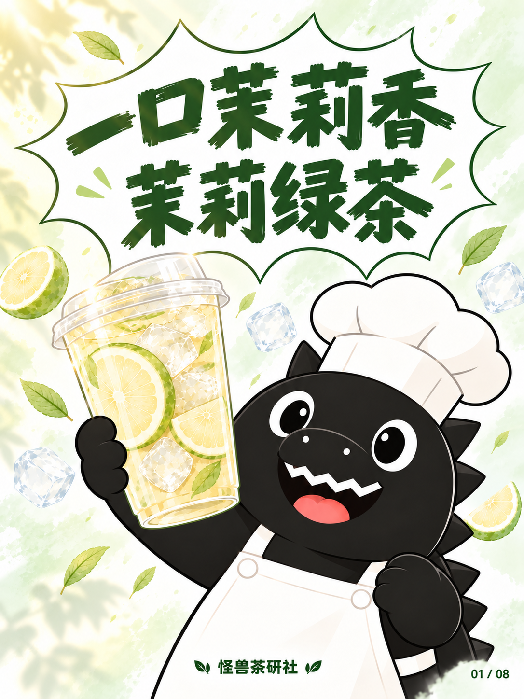
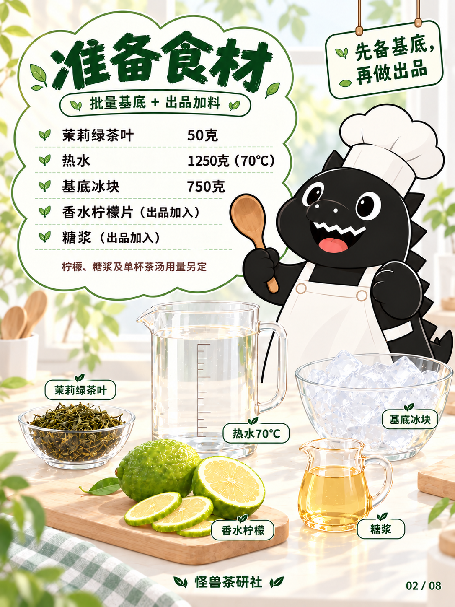
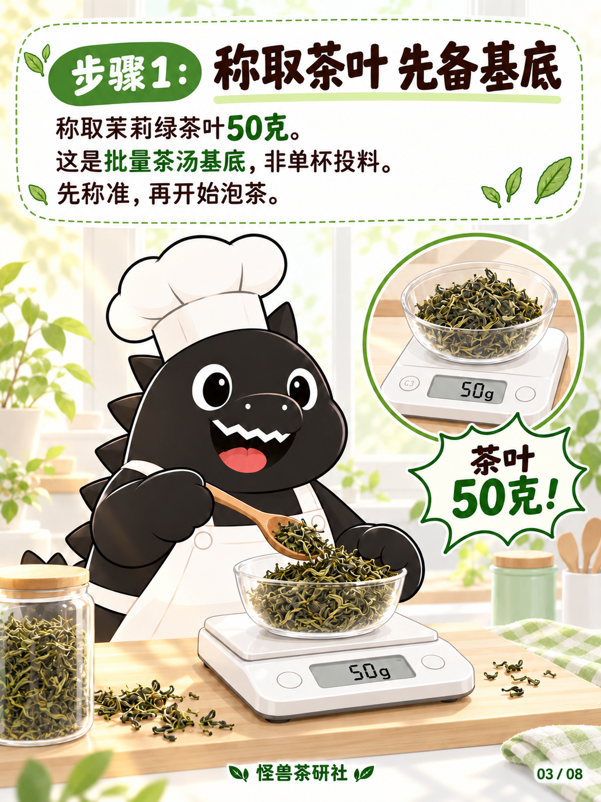
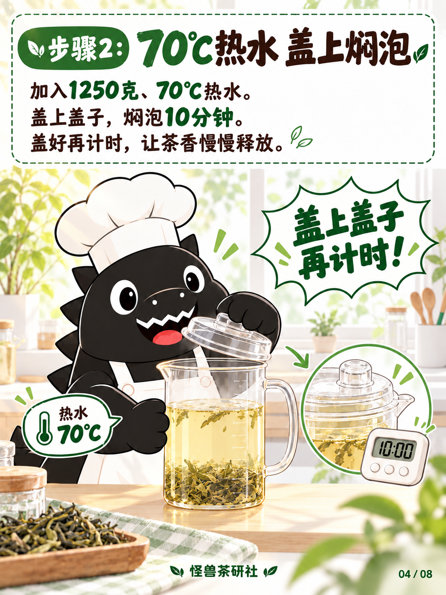
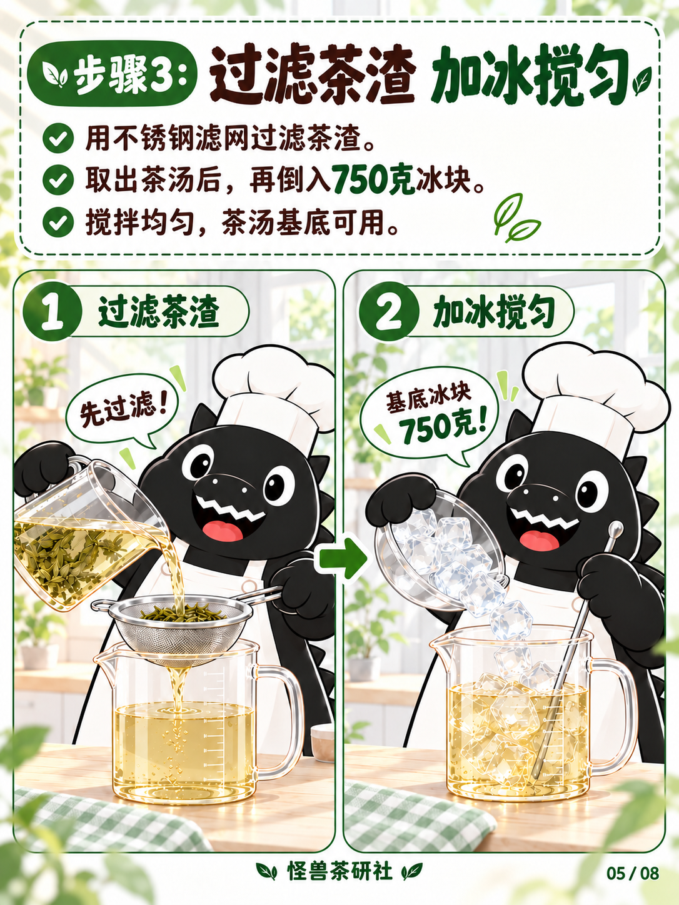
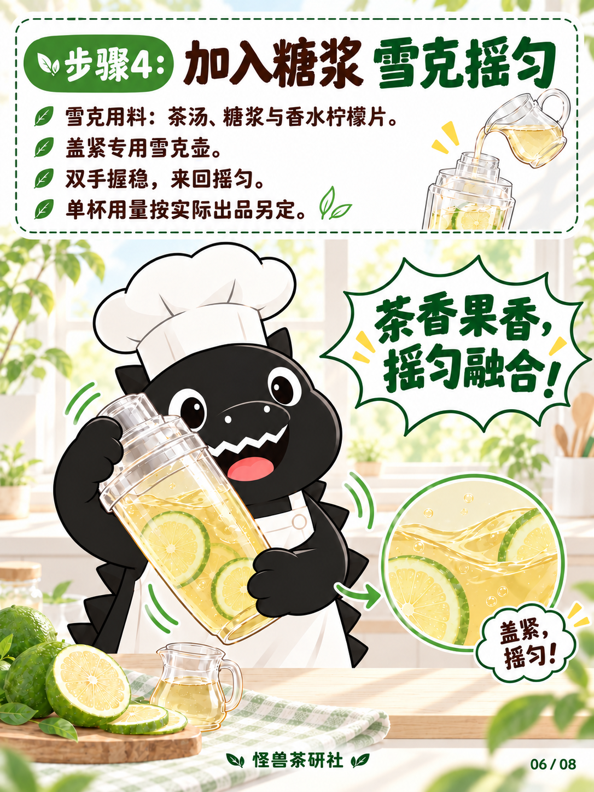
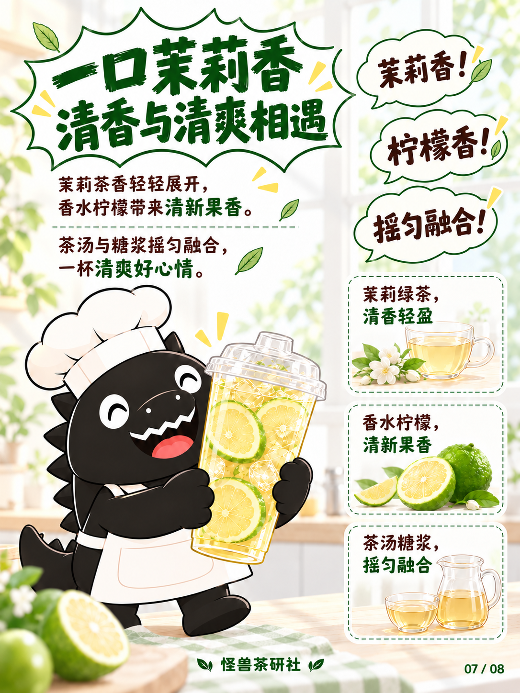
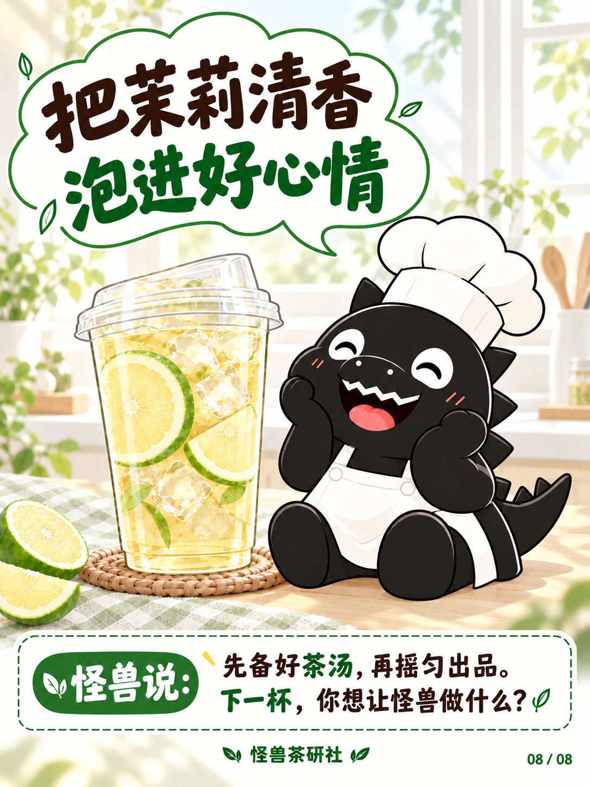

# 茉莉绿茶｜夏日微光试稿v4

保存日期：2026-10-14（Asia/Shanghai）。八页生成并核对完成，尚未宣告设计定稿。

按用户「阳光少少，有种夏日的感觉」要求，在[清朗淡雅试稿v3](../试稿-v3/README.md)基础上加入少量奶油色自然侧光、窗边与桌面的薄叶影、杯边柔和反光。近白浅绿仍为主要底色，说明区保持清晰白底；封面怪兽角度、位置、举杯与握拳姿势沿用已对齐版本。文案、配方、工具与八页结构保持。

## 当前八页

| 页码 | 图片 | 内容 |
| --- | --- | --- |
| 01 | [封面](图片/01-封面.png) | 原构图与姿态，淡淡夏日侧光 |
| 02 | [食材准备](图片/02-食材准备.png) | 云朵清单、基底与出品加料 |
| 03 | [称取茶叶](图片/03-称取茶叶.png) | 50克称茶、秤特写、非单杯提示 |
| 04 | [70℃焖泡](图片/04-70度焖泡.png) | 1250克、70℃热水，盖上焖泡10分钟 |
| 05 | [过滤加冰](图片/05-过滤加冰.png) | 双格：先过滤，再加750克冰块搅匀 |
| 06 | [糖浆雪克](图片/06-糖浆雪克.png) | 茶汤、糖浆与香水柠檬片，双手密封雪克 |
| 07 | [风味卖点](图片/07-风味卖点.png) | 三气泡、三张竖排卖点卡 |
| 08 | [成品收尾](图片/08-成品收尾.png) | 夏日窗光、坐姿怪兽与留言卡 |

图片1086×1448，原样保存未重新编码；校验与来源见[归档清单](归档清单.json)，实际逐页提示词见[生成提示词](生成提示词.json)，文案见[文案清单](文案清单.md)，配方见[当前配方](../../../当前配方.md)。糖浆、柠檬与单杯茶汤用量未指定，不补写数字。基底750克冰块保留，雪克壶内不画独立冰块。

v1—v3原样保留。v4图片、版本记录、生成提示词与本轮入口规范更新按用户要求纳入本次GitHub保存。

## 逐页预览

