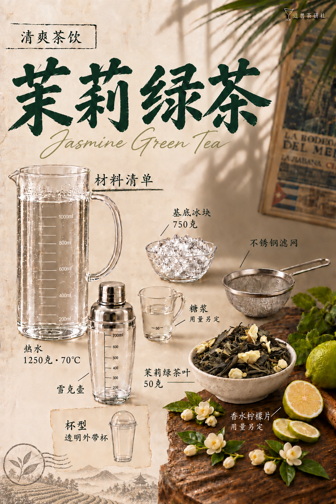

# 茉莉绿茶｜模板五试稿v13

保存日期：2026-10-15（Asia/Shanghai）。仅修改材料页左下风景装饰：替换为中国茶山、层叠茶垄、远山和小茶亭，保留淡灰褐复古线稿效果；印章中央换茶叶图案。横排标题、茶料、陶碗、桌面花饰、全部用量与器具摆位、背景光影和桌形沿用v12。

| 页码 | 图片 | 状态 |
| --- | --- | --- |
| 01 | [封面](图片/01-封面.png) | 沿用v9（原v3） |
| 02 | [材料清单](图片/02-材料清单.png) | 左下中国茶山风景修订 |
| 03 | [制作步骤](图片/03-制作步骤.png) | 沿用v9（原v3） |

本版按用户要求纳入GitHub版本保存；v9至v12保留，v4–v7仍取消。详见[归档清单](归档清单.json)、[生成提示词](生成提示词.json)与[文案清单](文案清单.md)。

