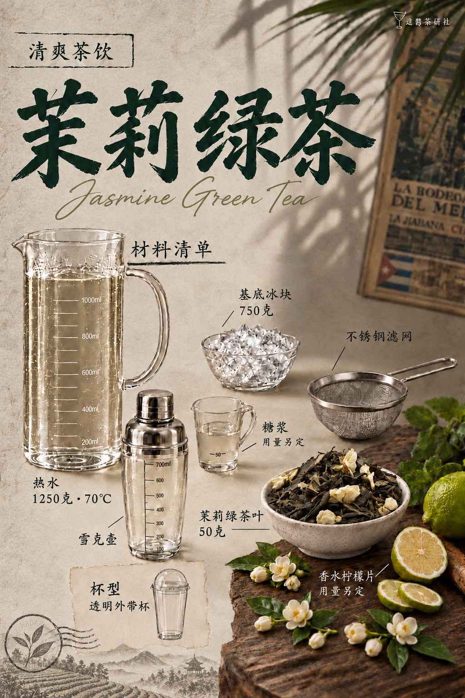

# 茉莉绿茶｜模板五试稿v16

保存日期：2026-10-15（Asia/Shanghai）。本版三页统一底色、色调和材质感，参照用户最初莫吉托原图的低饱和暖米灰／浅亚麻纸底、灰橄榄柔影、自然墨绿、灰棕木色、轻胶片颗粒和实拍质感，减轻偏黄橙与油亮感。保留v15四字横排标题、英文、中国茶山、同款步骤器具及全部物件位置和配方。旧版保留，本版按用户要求纳入GitHub版本保存。

| 页码 | 图片 | 本次变化 |
| --- | --- | --- |
| 01 | [封面](图片/01-封面.png) | 底色与材质统一，保留横排标题及中国茶山 |
| 02 | [材料清单](图片/02-材料清单.png) | 底色与材质统一，保留原摆位 |
| 03 | [制作步骤](图片/03-制作步骤.png) | 底色与材质统一，保留横排标题及中国茶山及同款器具 |

步骤01焖泡壶采用高直圆筒刻度玻璃壶与大弧把手，操作时配薄透明盖；02滤网架于同款接茶壶口，茶渣留网中，茶滴从网底进入壶，去掉误生成的跨步骤壶底茶流；03加冰搅拌使用直筒刻度玻璃壶；04透明刻度金属盖专用雪克壶，双手握盖和托底。小图按动作位置缩放，配方文字不变。

茶叶50克、1250克70℃热水、盖上焖泡10分钟、过滤后加750克冰搅匀；雪克用茶汤、糖浆、香水柠檬片，壶内无独立冰块。单杯用量未确认，不补写数字。本版三页均为单行中文主标题与下方英文。

详见[文案清单](文案清单.md)、[生成提示词](生成提示词.json)、[归档清单](归档清单.json)及[当前配方](../../../当前配方.md)。全部图片1024×1536，原字节保存。

## 三页预览

