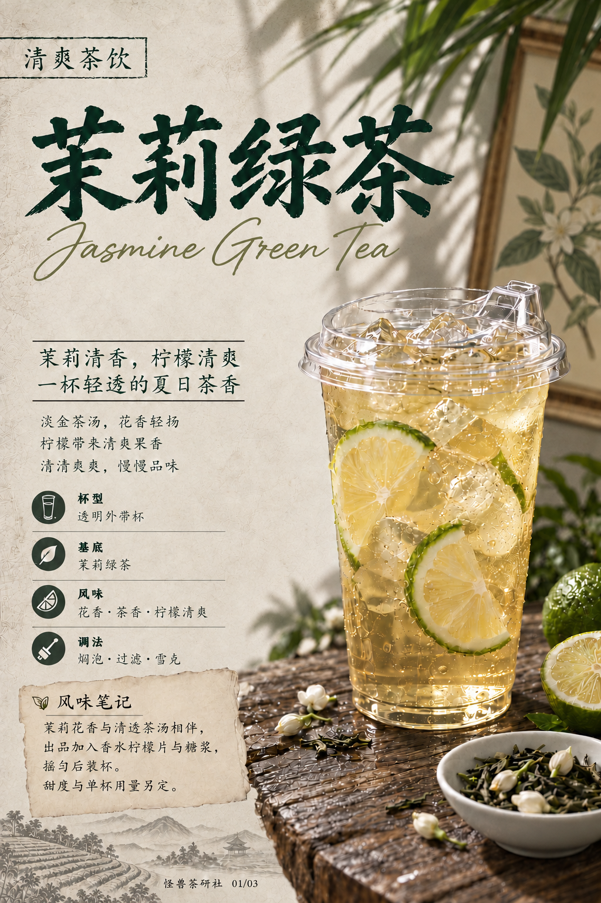
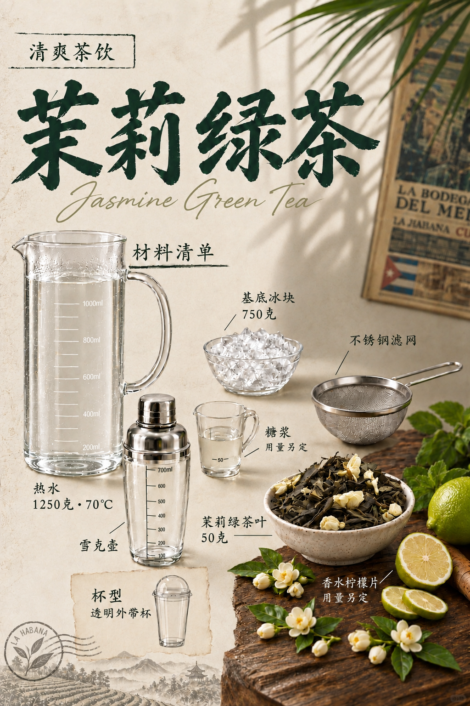
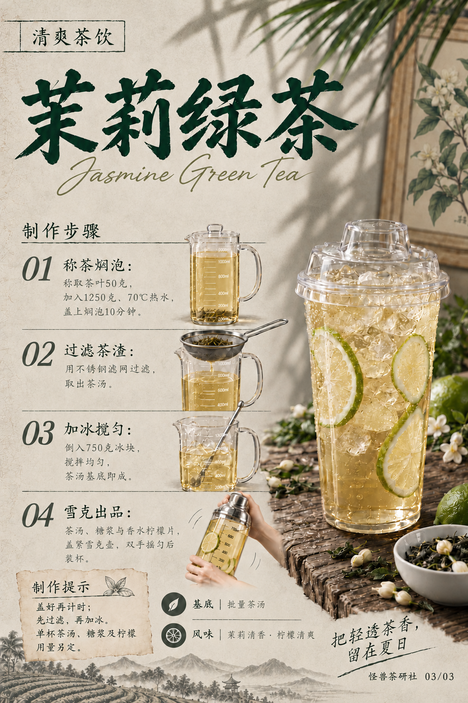

# 茉莉绿茶｜模板五试稿v17

保存日期：2026-10-15（Asia/Shanghai）。仅修改材料清单页：用户认为v16调色过重，按新附莫吉托原图减轻灰褐滤镜、反差与颗粒，恢复自然浅米灰；热水壶液体保持无色清澈透明。标题、文字用量、布局、器具款式、茶山及桌形不变。封面与步骤页原样沿用v16。旧版保留，本版按用户要求纳入GitHub版本保存。

| 页码 | 图片 | 本次变化 |
| --- | --- | --- |
| 01 | [封面](图片/01-封面.png) | 原样沿用v16 |
| 02 | [材料清单](图片/02-材料清单.png) | 减轻调色，热水无色清透 |
| 03 | [制作步骤](图片/03-制作步骤.png) | 原样沿用v16及同款器具 |

步骤01焖泡壶采用高直圆筒刻度玻璃壶与大弧把手，操作时配薄透明盖；02滤网架于同款接茶壶口，茶渣留网中，茶滴从网底进入壶，去掉误生成的跨步骤壶底茶流；03加冰搅拌使用直筒刻度玻璃壶；04透明刻度金属盖专用雪克壶，双手握盖和托底。小图按动作位置缩放，配方文字不变。

茶叶50克、1250克70℃热水、盖上焖泡10分钟、过滤后加750克冰搅匀；雪克用茶汤、糖浆、香水柠檬片，壶内无独立冰块。单杯用量未确认，不补写数字。本版三页均为单行中文主标题与下方英文。

详见[文案清单](文案清单.md)、[生成提示词](生成提示词.json)、[归档清单](归档清单.json)及[当前配方](../../../当前配方.md)。全部图片1024×1536，原字节保存。

## 三页预览

