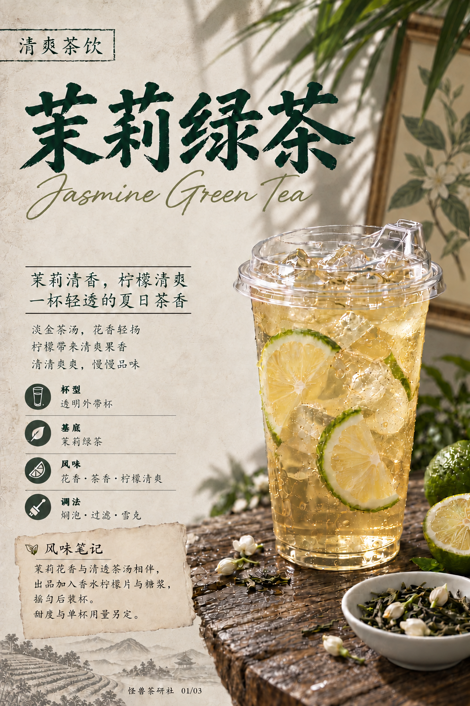
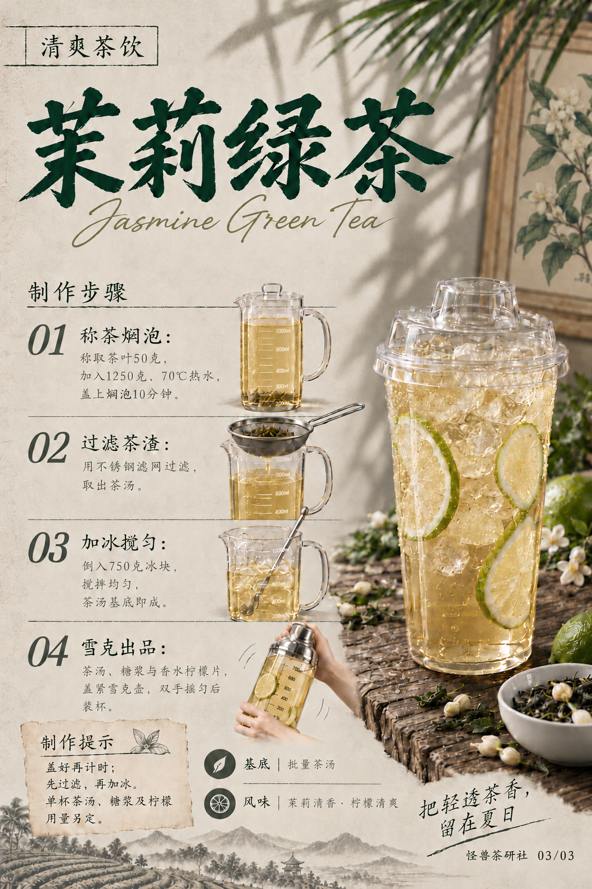

# 茉莉绿茶｜模板五试稿v19

保存日期：2026-10-15（Asia/Shanghai）。本次修正当前三页所有出现的「焖」字，统一标准简体字形：火字旁、门内心（U+7116）。配方、字号位置和原布局保持。

| 页码 | 图片 | 修订 |
| --- | --- | --- |
| 01 | [封面](图片/01-封面.png) | 调法「焖泡·过滤·雪克」 |
| 02 | [材料清单](图片/02-材料清单.png) | 无焖字，原样沿用v18，清透热水和无黑点冰块保留 |
| 03 | [制作步骤](图片/03-制作步骤.png) | 「称茶焖泡」「盖上焖泡10分钟」 |

旧版保留，本版按用户要求纳入GitHub版本保存。详见[文案清单](文案清单.md)、[生成提示词](生成提示词.json)、[归档清单](归档清单.json)和[当前配方](../../../当前配方.md)。

## 三页预览

