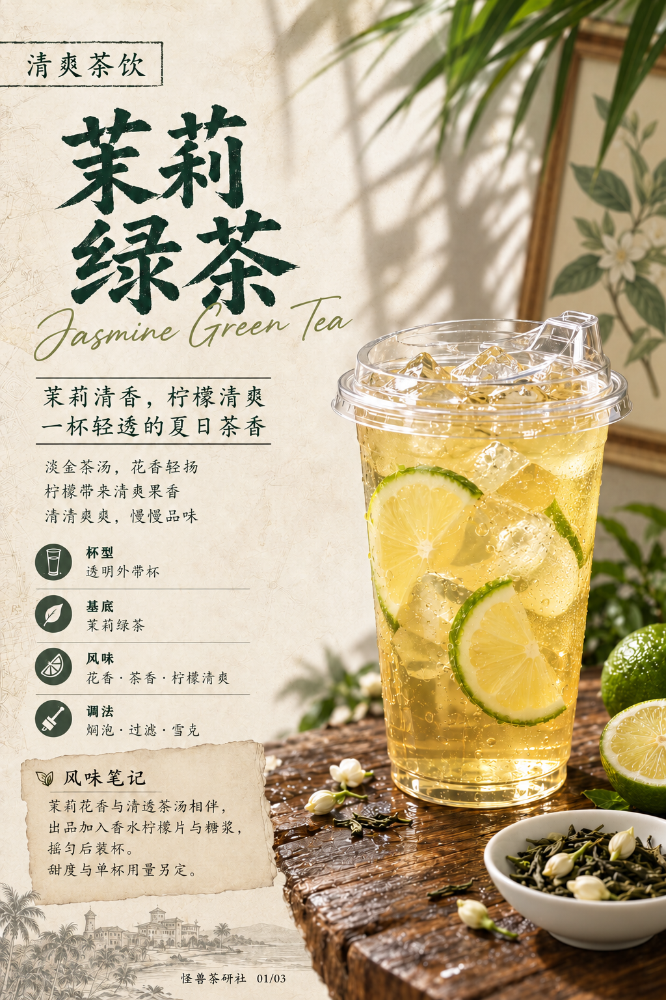
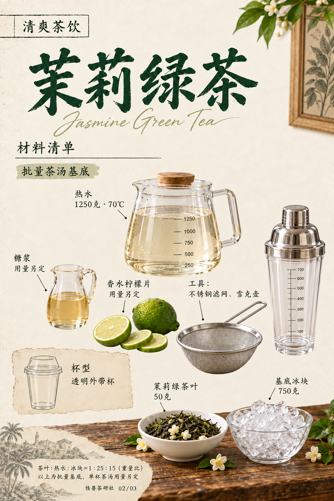

# 茉莉绿茶｜模板五试稿v2

保存日期：2026-10-15（Asia/Shanghai）。三页已生成，采用「经典莫吉托」参考的复古纸页与写实摄影布局，换成项目当前茉莉绿茶配方。默认无怪兽，本版按用户要求纳入GitHub版本保存。

本次仅修改材料清单页：去掉中间光线阴影、石台面和桌面感；茉莉茶叶与冰块放在底部木桌，其他材料及器具置于米白留白区。用量不变。封面与步骤页沿用v1，v1完整保留。

## 三页图片

| 页码 | 页面 | 布局 |
| --- | --- | --- |
| 01 | [封面](图片/01-封面.png) | 左侧书法标题、风味信息及便签，右侧成品大杯 |
| 02 | [材料清单](图片/02-材料清单.png) | 中间纸面无光影，茶叶与冰块置底部木桌，其他原料与工具置留白区 |
| 03 | [制作步骤](图片/03-制作步骤.png) | 左侧四步与操作图、右侧成品、底部制作提示 |

配方：茉莉绿茶叶50克，1250克70℃热水，盖上焖泡10分钟，不锈钢滤网过滤后倒入750克冰块搅匀。出品以茶汤、糖浆和绿皮香水柠檬片盖紧专用雪克壶、双手摇匀后装杯。未补写单杯茶汤、糖浆和柠檬的用量，也不补写雪克时间。

三页无原作者账号、酒品牌或酒精度，背景招牌改为植物画；材料页及步骤页已区分专用雪克壶与透明饮口盖外带杯。雪克壶内不画独立冰块，成品杯保留现有冰块视觉。封面用风味笔记代替未核实历史。所有图片1024×1536，原输出字节直接保存；修改前图保存在过程稿，旧模板不覆盖。

详见[文案清单](文案清单.md)、[生成提示词](生成提示词.json)、[归档清单](归档清单.json)、[当前配方](../../../当前配方.md)。用户原始参考JPG未按字节归档，生成图片不等于原参考文件。

## 逐页预览

