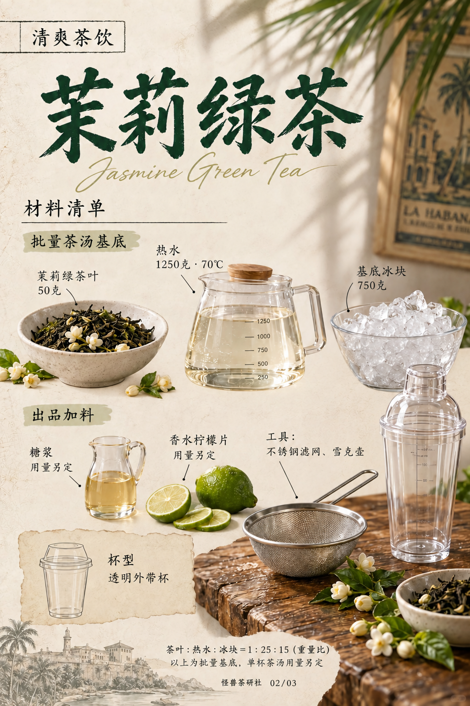
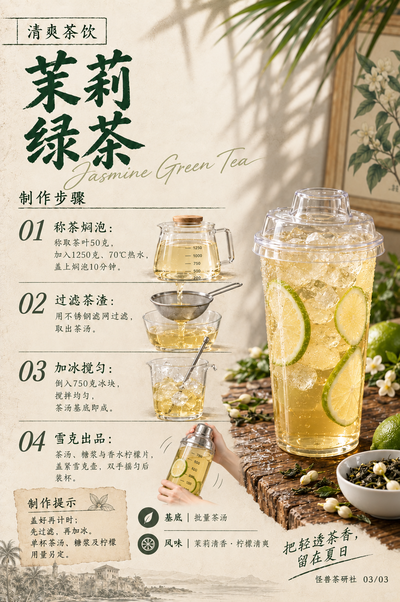

# 茉莉绿茶｜模板五试稿v3

保存日期：2026-10-15（Asia/Shanghai）。本次仅局部修改材料页，依据用户补发的红框标注原图：清理茶叶碗、水壶和冰碗下方的横向台面与条状阴影，融合为米白纸底；移除红色标注。食材、文字、用量、背景叶影及右下木桌按该标注原图保留，不采用v2的大幅重排。

封面与步骤页沿用v1，材料页按用户指定标注原图恢复，因此材料页保留其原有背景画、茶碗和右侧器具造型；本次未扩展修改这些区域。v1与v2完整保留，本版按用户要求纳入GitHub版本保存。

| 页码 | 页面 | 状态 |
| --- | --- | --- |
| 01 | [封面](图片/01-封面.png) | 沿用v1 |
| 02 | [材料清单](图片/02-材料清单.png) | 仅清理红框内背景台面光影，原位陈列 |
| 03 | [制作步骤](图片/03-制作步骤.png) | 沿用v1 |

配方及文案见[文案清单](文案清单.md)和[当前配方](../../../当前配方.md)，生成过程见[提示词](生成提示词.json)与[归档清单](归档清单.json)。图片1024×1536，按原输出字节保存。

## 逐页预览

