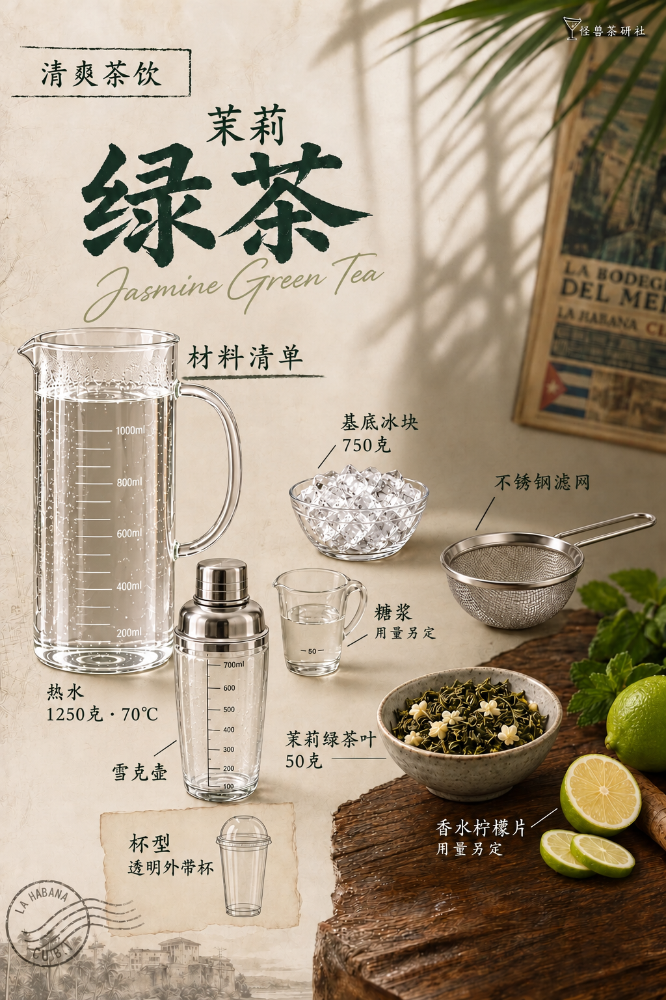

# 茉莉绿茶｜模板五试稿v8

保存日期：2026-10-15（Asia/Shanghai）。按用户新上传红字标注原图重新替换材料，不沿用已取消的v4–v7布局。原酒瓶处换模板一高直筒刻度玻璃热水壶；青柠汁处换冰碗；薄荷杯处换不锈钢滤网；苏打瓶处换雪克壶；糖浆保留原图矮刻度量杯款式；桌上碎冰碗换茉莉干茶碗；柠檬在原区域换香水柠檬。背景、植物光影、桌形及物件对应位置以本轮标注参考为准。

图片为生成试稿，供用户核对比例与位置，未声称与原图像素级一致。未知出品用量写用量另定。热水1250克、70℃，基底冰块750克，茶叶50克。

| 页码 | 图片 | 状态 |
| --- | --- | --- |
| 01 | [封面](图片/01-封面.png) | 沿用v3 |
| 02 | [材料清单](图片/02-材料清单.png) | 原图标注逐项替换 |
| 03 | [制作步骤](图片/03-制作步骤.png) | 沿用v3 |

本版按用户要求纳入GitHub版本保存；v4–v7仍已取消，不作为后续依据。详见[归档清单](归档清单.json)和[生成提示词](生成提示词.json)。

