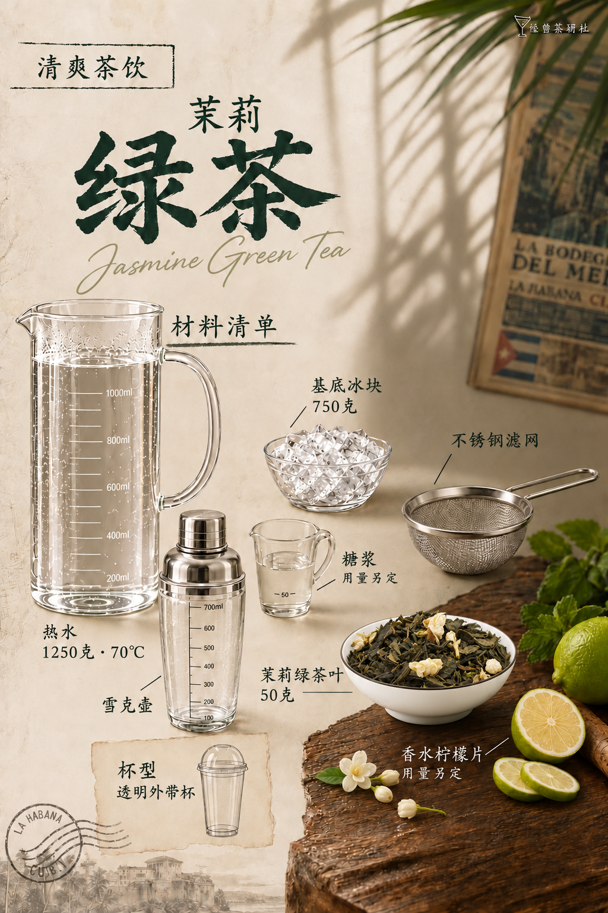

# 茉莉绿茶｜模板五试稿v9

保存日期：2026-10-15（Asia/Shanghai）。仅局部修改材料页：按用户干茶实拍参考，将茶叶碗改为素白浅瓷碗、自然墨绿干茶与少量奶白干茉莉花苞；在木桌空白处增添少量茉莉花、花苞点缀。其他器具、位置、文字、用量、背景光影与桌子造型沿用v8。桌面鲜花仅为装饰，不加入配方或杯内。

v8原版保留，v4–v7仍取消，本版按用户要求纳入GitHub版本保存。

| 页码 | 图片 | 状态 |
| --- | --- | --- |
| 01 | [封面](图片/01-封面.png) | 沿用v3 |
| 02 | [材料清单](图片/02-材料清单.png) | 白瓷碗干茶与桌面茉莉花局部修订 |
| 03 | [制作步骤](图片/03-制作步骤.png) | 沿用v3 |

本版按用户要求纳入GitHub版本保存；v4–v7仍已取消，不作为后续依据。详见[归档清单](归档清单.json)和[生成提示词](生成提示词.json)。

