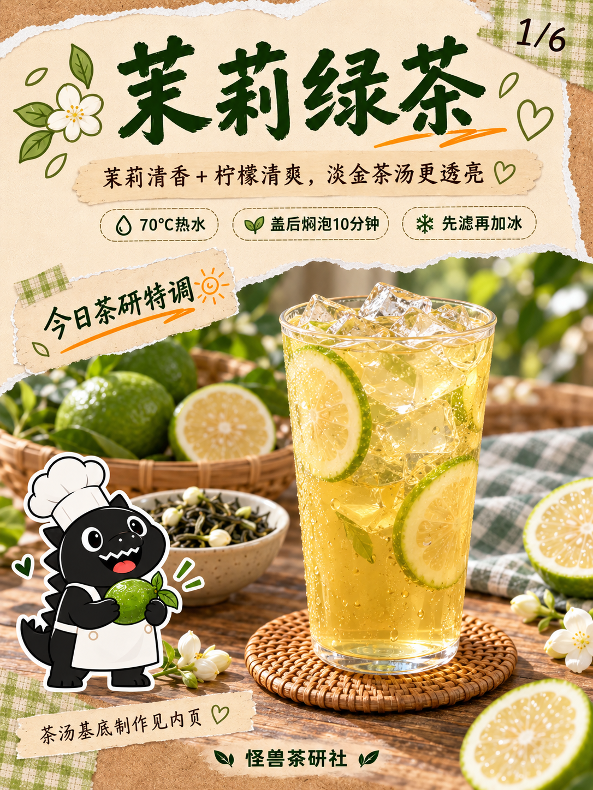
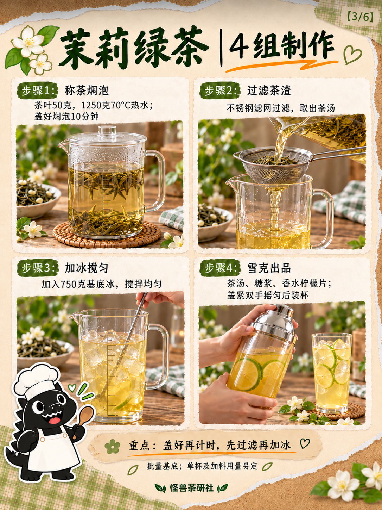
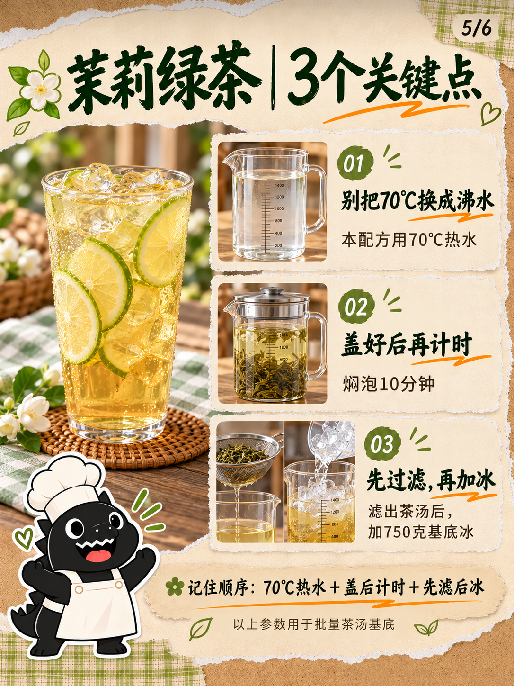

# 模板八｜茉莉绿茶六页试稿v1

2026-10-18（Asia/Shanghai）。按视频六页结构替换茉莉绿茶，并依用户追加要求将人物贴纸全部改为模板三的黑色厨师怪兽。保留奶油撕纸、墨绿书法、橙色划线、格纹胶带和真实日光木桌摄影；不将整页套成模板三漫画风。

六页依次为封面、材料、四组制作、口感、三个关键点、调整建议。现有模板一至七及原视频提取帧保留，本六页依用户指令归为模板八。

配方为批量50克茶叶、1250克70℃热水、盖后焖泡10分钟、过滤后750克冰搅匀。出品茶汤、糖浆和绿皮香水柠檬片雪克，单杯及加料用量另定。原参考蜂蜜、薄荷、苏打水和一杯180ml未迁入。

[文案清单](文案清单.md)｜[真实生成提示词](生成提示词.json)｜[尺寸及SHA-256清单](归档清单.json)。首次被用户中断时已完成的女孩材料稿只作过程记录，当前页采用怪兽版。按用户要求纳入GitHub版本保存，供后续继续修改。

