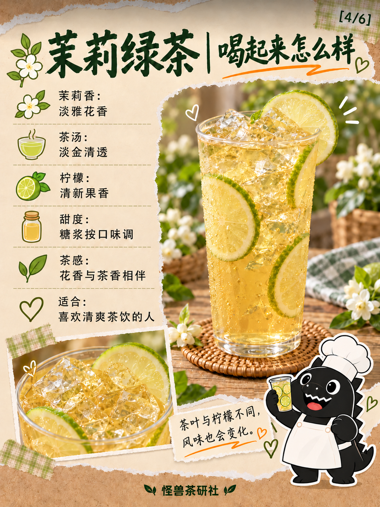
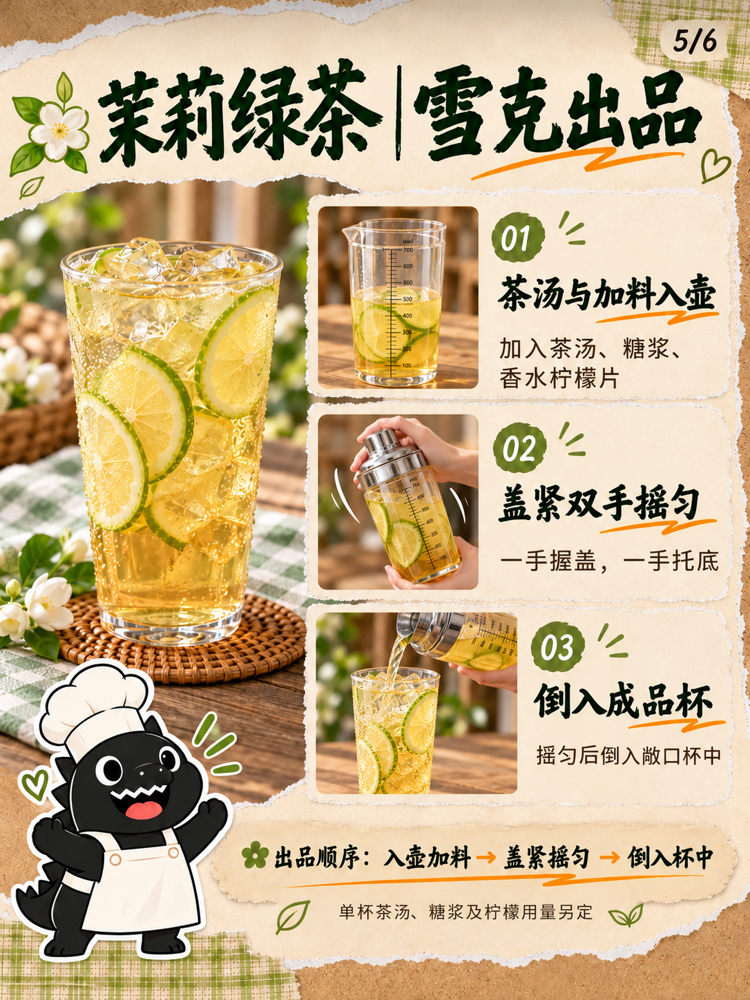

# 模板八｜茉莉绿茶六页试稿v2

2026-10-18（Asia/Shanghai）。按用户要求把茶汤基底与雪克过程分别放在第03和05页：

- 第03页四组只从称取茶叶到茶汤完成：称茶注水、盖上焖泡、过滤茶渣、加冰搅匀。
- 第05页保留左侧成品图、怪兽贴纸和原版式；右侧三张照片改为茶汤及加料入壶、盖紧双手雪克、倒入敞口成品杯；标题与底部说明同步改为出品流程。
- 第01、02、04、06页原字节沿用v1，旧版保留。

配方数字与未知用量规则不变，750克基底冰只在第三页批量制作时加入。雪克壶不另画独立冰块。按用户要求纳入GitHub版本保存，旧版保留。

[文案清单](文案清单.md)｜[真实提示词](生成提示词.json)｜[像素及SHA-256](归档清单.json)

