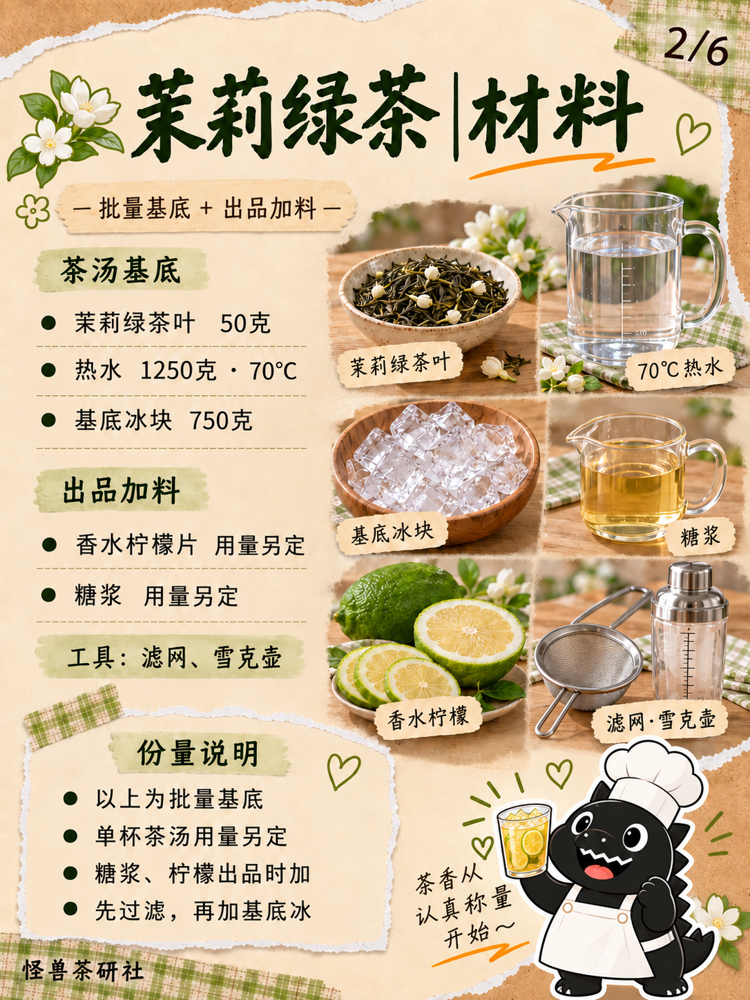
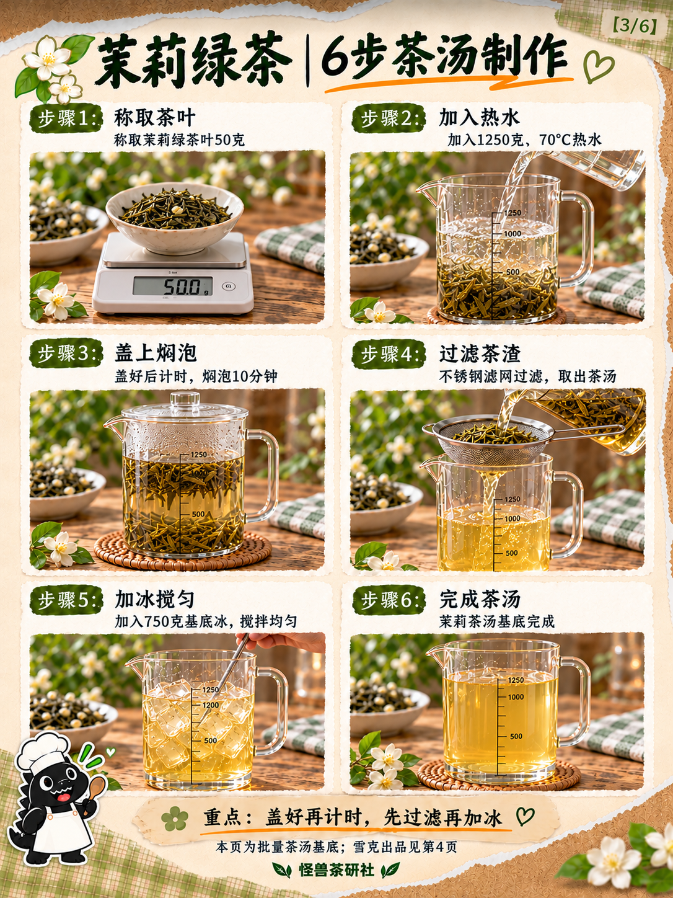
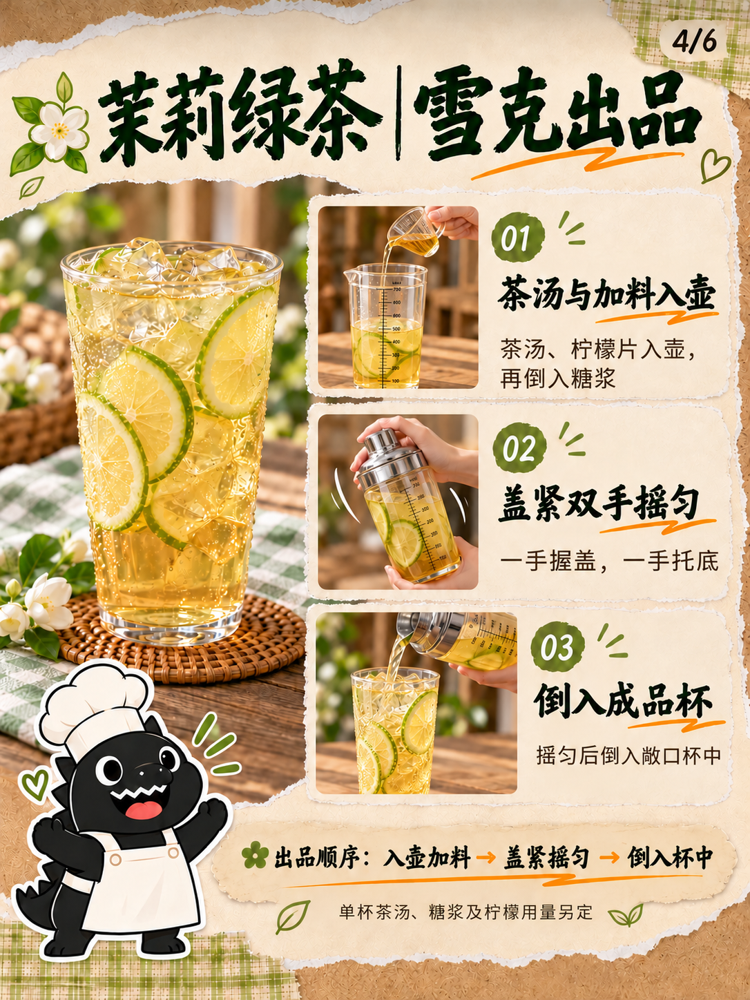
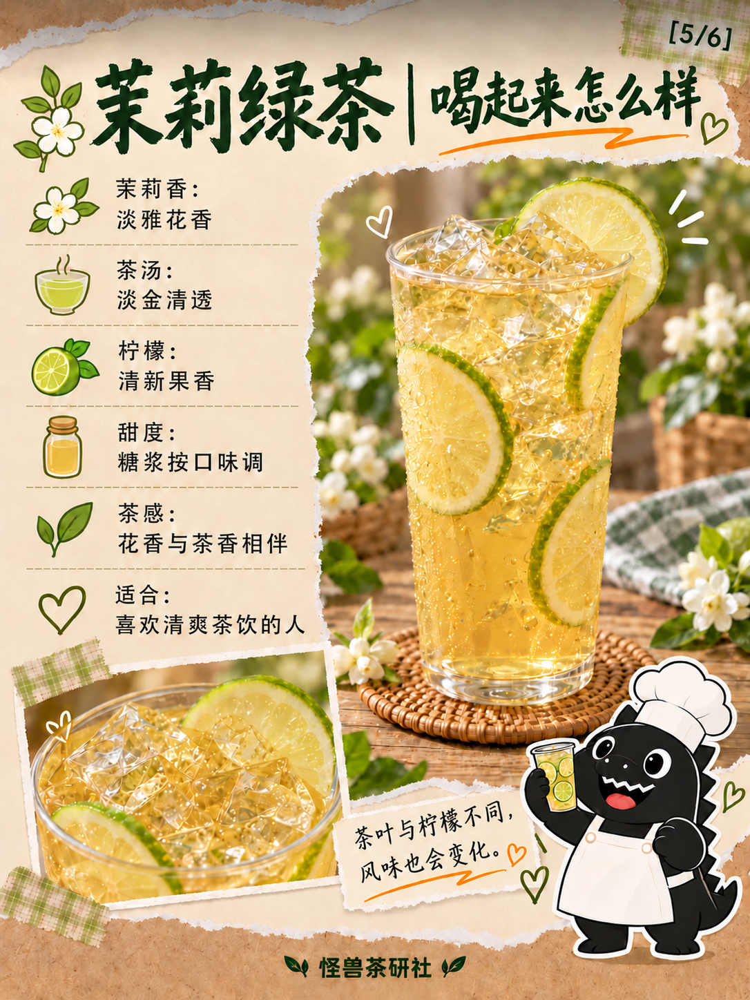
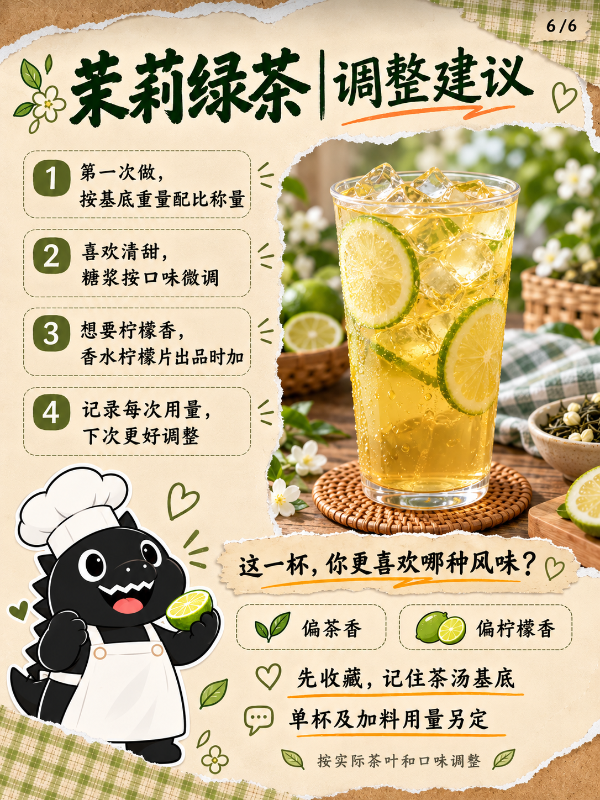

# 模板八｜茉莉绿茶六页试稿v3

2026-10-18（Asia/Shanghai）。按用户要求完成三项修订：

- 第03页由四组扩为两列三行六步：称茶、注水、焖泡、过滤、加冰搅匀、完成茶汤。
- 雪克第一步明确画小量杯将糖浆倒入敞口雪克壶，已在壶中准备茶汤与柠檬片。
- 雪克页移到第04页（4/6），口感说明移到第05页（5/6）；制作页交叉提示同步指向第4页。

第01、02、06页按v2原字节复制。第三页到完成批量茶汤为止，第四页专讲单杯雪克出品，未知单杯用量仍另定。模板三厨师怪兽及整体撕纸实拍风保留，v1/v2保留。按用户要求纳入GitHub版本保存。

[文案清单](文案清单.md)｜[真实生成提示词](生成提示词.json)｜[像素及SHA-256](归档清单.json)

