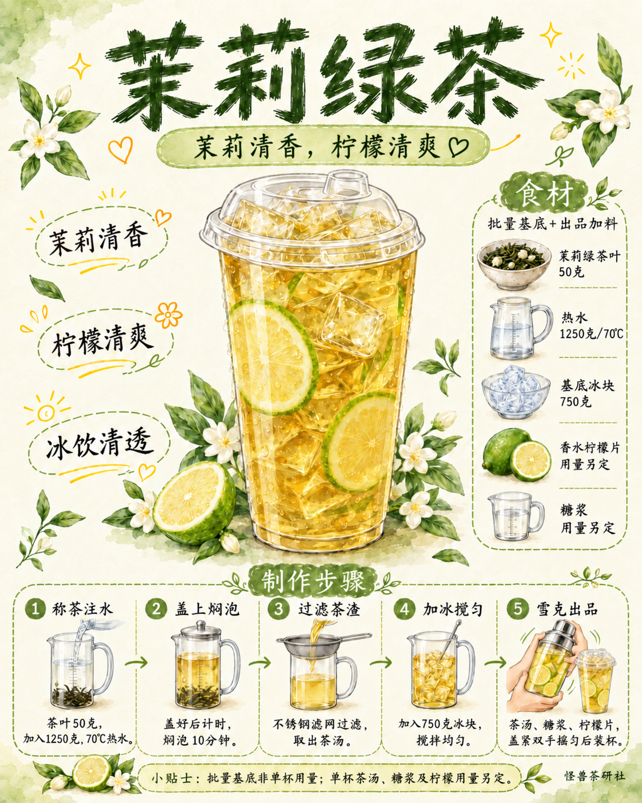

# 茉莉绿茶｜模板六试稿v2

保存日期：2026-10-16（Asia/Shanghai）。本次仅去掉杯盖右侧杯外柠檬片，杯内柠檬与其他内容保留，v1原版保留。按用户「拆解，更换主题」要求，拆解柠檬冰红茶参考，并沿用当前茉莉绿茶主题制作单页。保留4:5单页结构：顶部横排标题与短句、中央大杯、左三卖点、右食材栏、底部五格操作及贴士。浅茶绿、墨绿与浅金水彩，米白纸底，默认无怪兽。

配方：茉莉绿茶叶50克、1250克70℃热水、盖上焖泡10分钟、钢滤网过滤后加750克冰搅匀；出品茶汤、糖浆和绿皮香水柠檬片盖紧双手雪克后装杯。单杯与加料用量另定，不继承参考红茶／蜂蜜／薄荷和饮用水打底步骤。

成品杯已补透明凸起饮口盖；雪克保持专用金属盖壶，壶内无独立冰块。修订前图保留在过程稿。实际图片1122×1402，原字节保存，未重新编码；版式按4:5参考生成。

[查看海报](图片/01-茉莉绿茶单页海报.png) · [文案清单](文案清单.md) · [生成提示词](生成提示词.json) · [归档清单](归档清单.json) · [模板拆解](../../视觉与版式拆解.md)

本版按用户要求纳入GitHub版本保存，旧模板与旧试稿保留。

