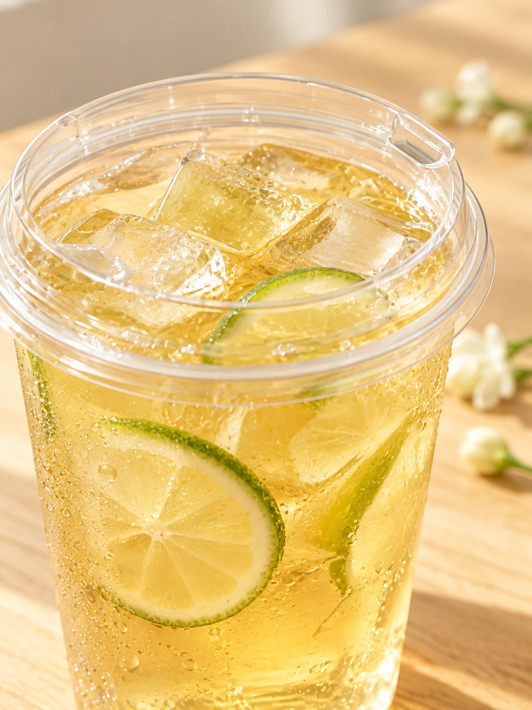

# 茉莉绿茶｜模板六封面＋日光实拍内页｜试稿v1

日期：2026-10-16（Asia/Shanghai）。用户已确认沿用茉莉绿茶。共四页：封面直接复用模板六v3，三张内页按本轮芒果参考的摄影结构新生成。

| 页码 | 文件 | 内容 |
| --- | --- | --- |
| 01 | [封面](图片/01-封面-模板六v3.png) | 模板六水彩单页，原字节复用 |
| 02 | [食材实拍](图片/02-食材实拍.png) | 日光木桌、实际原料、虚线标签；水壶刻度已校正 |
| 03 | [六格制作](图片/03-六格制作步骤.png) | 三列两行连续01—06，真实茉莉绿茶流程 |
| 04 | [成品特写](图片/04-成品特写.png) | 无字近景、淡金茶汤、绿柠檬、透明直饮盖 |

封面保持约4:5，三张内页约3:4，均保留生成文件实际像素，未拉伸或裁图。配方按当前记录：50克茶叶、1250克70℃热水、盖上焖泡10分钟、过滤、加入750克基底冰块搅匀；茶汤、糖浆、香水柠檬片雪克，单杯与加料用量另定。

[文案](文案清单.md)｜[真实生成提示词](生成提示词.json)｜[像素与SHA-256清单](归档清单.json)｜[可复用拆解](../../视觉与逐页拆解.md)。食材页刻度修正前的图另存过程稿，不作为当前页。

按用户要求纳入GitHub版本保存。

