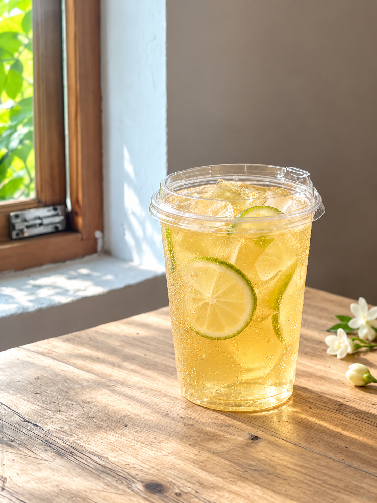

# 茉莉绿茶｜试稿v2｜窗边全杯成品照

日期：2026-10-16（Asia/Shanghai）。仅修改第04页构图：由满版近景改为参考照片的窗边完整杯身，主体偏右、左侧木窗、暖灰墙与木桌留白。杯型仍为透明外带杯与直饮盖，茶汤和配料沿用茉莉绿茶。前三页按试稿v1原字节复制，试稿v1完整保留。

按用户要求纳入GitHub版本保存。

[生成提示词](生成提示词.json)｜[归档清单](归档清单.json)｜[文案清单](文案清单.md)

