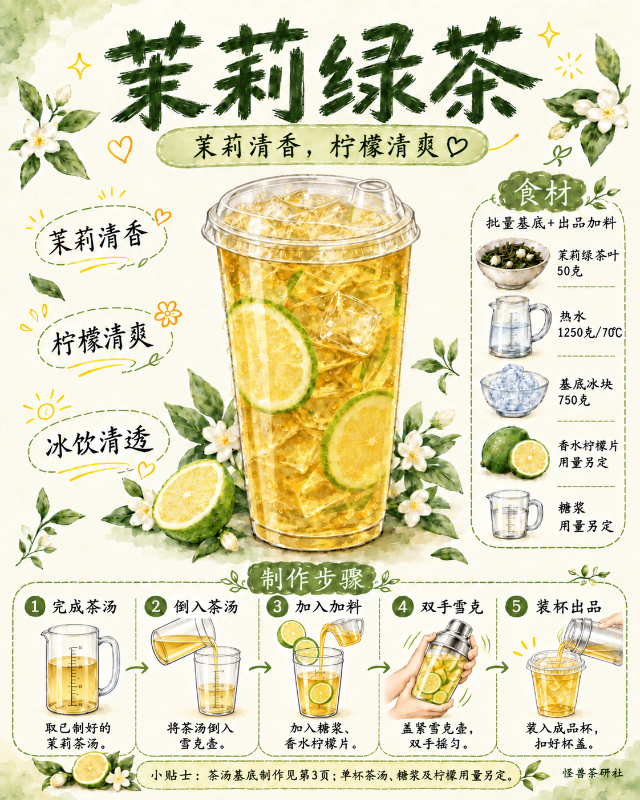

# 模板六衍生版｜茉莉绿茶试稿v4

2026-10-16（Asia/Shanghai）。按用户要求划分流程：封面从完成茶汤开始展示出品；第三页只展示称茶至完成茶汤。仅修订第01与03页；第02食材及第04窗边无logo细高杯照按v3原字节沿用。

封面五格：完成茶汤 → 倒入茶汤 → 加入加料 → 双手雪克 → 装杯出品。

第三页六格：称取茶叶 → 加入热水 → 盖上焖泡 → 过滤茶渣 → 加冰搅匀 → 完成茶汤。上方产品图对应整壶茶汤基底。50克、1250克70℃、盖上后10分钟及750克基底冰不变，单杯用量另定。

封面原中央成品杯和装饰保留；本轮未同步改为第四页细高平盖杯。旧版均保留，按用户要求纳入GitHub版本保存。

[文案清单](文案清单.md)｜[真实提示词](生成提示词.json)｜[归档清单](归档清单.json)

