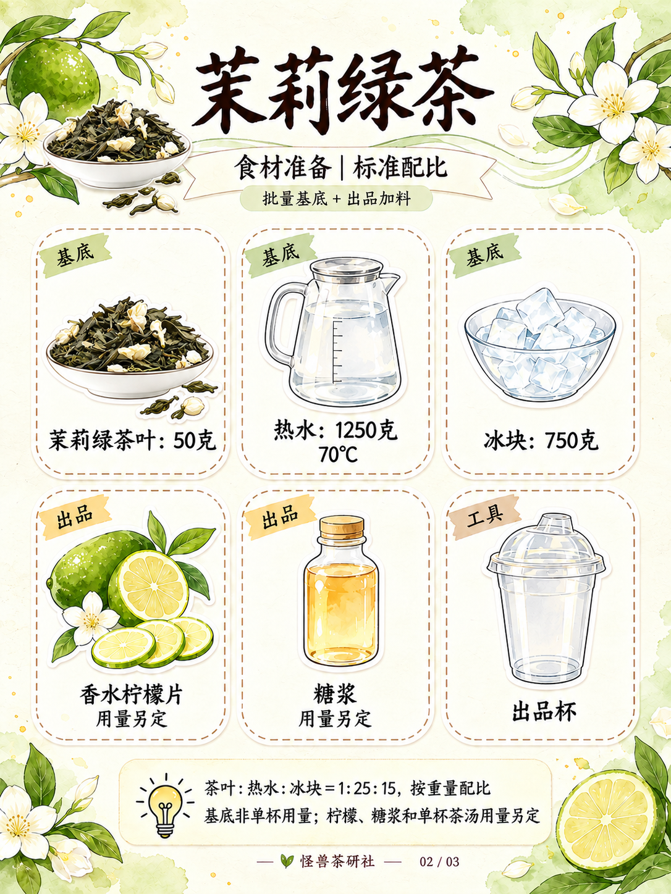
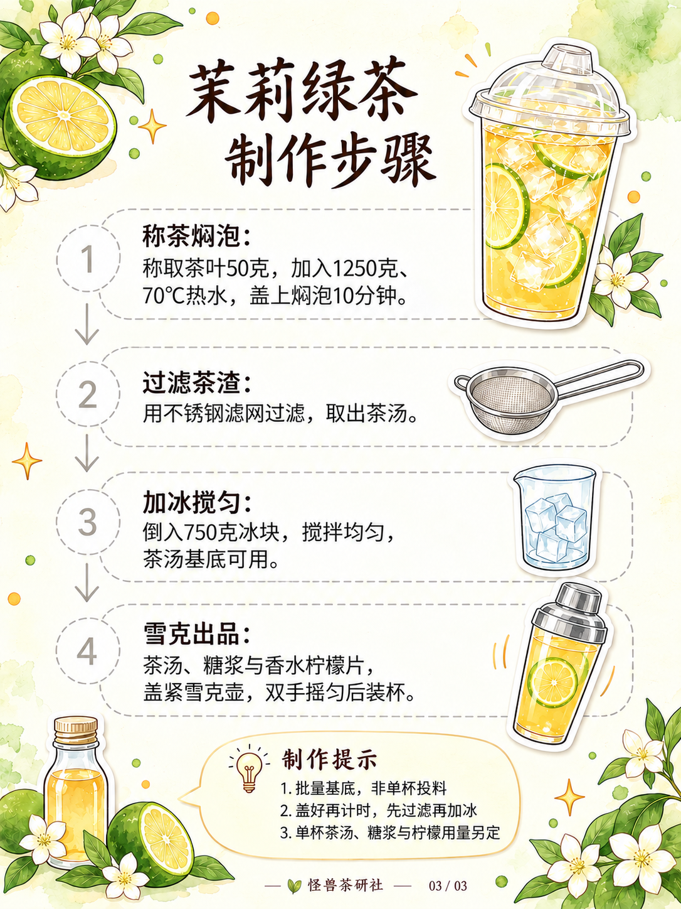

# 茉莉绿茶｜模板四试稿v2

保存日期：2026-10-15（Asia/Shanghai）。按用户要求，将「橙香茉莉椰」参考替换为茉莉绿茶。三页已生成并核对，尚未宣告设计定稿。

采用模板四奶油纸底、浅茶绿与浅金水彩、白边贴纸、深棕手写字和细虚线框，默认无人物。保留原参考的三页信息结构；配方采用怪兽茶研社最新茉莉绿茶配方，不继承橙、椰乳、蜂蜜及原参考单杯数字。

## 三页图片

| 页码 | 图片 | 内容 |
| --- | --- | --- |
| 01 | [封面配方总览](图片/01-封面配方总览.png) | 右侧成品大杯、左侧食材与四步流程、右下关键提示 |
| 02 | [食材准备](图片/02-食材准备.png) | 三列两行：三项基底、两项出品加料、一个工具杯 |
| 03 | [制作步骤](图片/03-制作步骤.png) | 编号圆圈、纵向虚线步骤条、箭头与底部提示 |

配方：茶叶50克，加入1250克、70℃热水，盖上焖泡10分钟；用不锈钢滤网过滤后，加750克冰块搅匀。雪克用料为茶汤、糖浆与绿皮香水柠檬片，盖紧专用壶、双手摇匀后装杯。糖浆、柠檬及单杯茶汤用量未确认，不补写数字。封面与步骤页的杯底已清理为均匀茶汤，雪克壶中不画独立冰块；成品杯冰块沿用既有成品视觉。

详见[文案清单](文案清单.md)、[当前配方](../../../当前配方.md)、[归档清单](归档清单.json)及[生成提示词](生成提示词.json)。图片1086×1448，原样保存未重新编码；局部清理前图片另存过程稿，不作为当前图使用。参考原附件字节尚未归档，本版生成图不等于用户原参考图。

本轮按用户实物参考修改封面茶叶图标及食材页两处茶叶：素白浅瓷碗、细长墨绿干茶、少量奶白茉莉花苞；保留水彩贴纸风。步骤页沿用v1。v1完整保留，本版按用户要求纳入GitHub版本保存。

## 逐页预览

